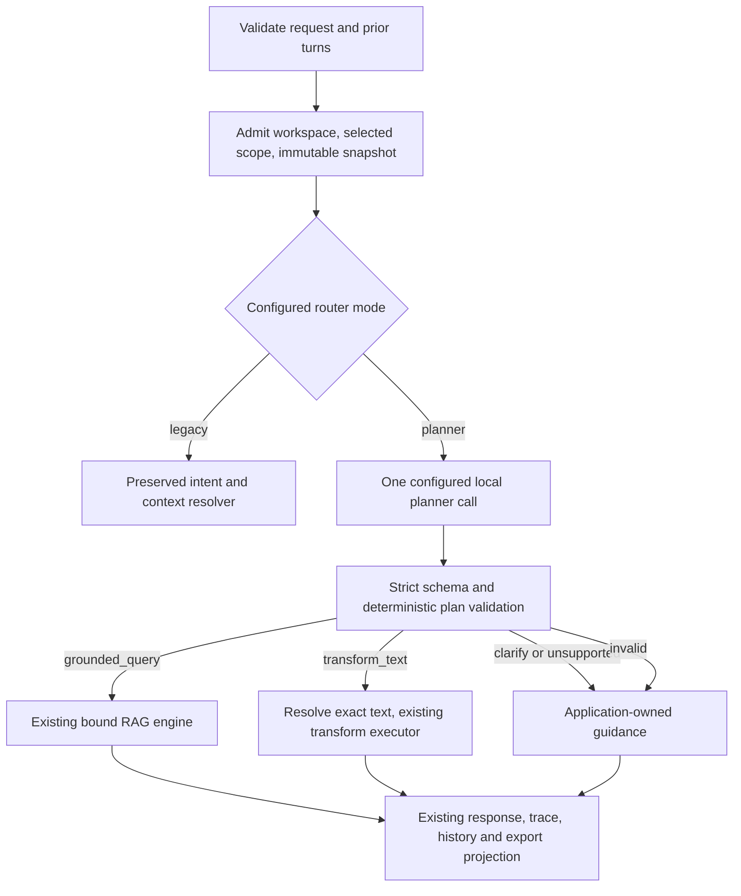

# BETA-CONV-01A — LLM task planning architecture amendment

**Status:** HUMAN-ACCEPTED DESIGN / IMPLEMENTATION AUTHORIZED

**Authority:** Human-supplied BETA-CONV-01A architecture/evaluation handoff,
2026-11-05; design, documentation, and archive creation only.

**Design baseline:** canonical `main`,
`dfc045f4178db41f723feb0483e8f163a801bc40`.

**Design branch:** `design/beta-conv-01a-llm-task-planning`.

**Parent accepted design:** `b61570f0815aaaa44d632d82c1fc50f63c673884`.

**Preserved implementation:** `64b5883311338689f291f181e47686fc1a9e3906`;
BETA-CONV-01 implementation IR-005 ACCEPT — code review.

**Planner implementation, model evaluation, activation, and promotion:**
Implementation is authorized by the Human acceptance below. Model evaluation,
planner activation and implementation promotion are NOT AUTHORIZED. BETA-CONV-02
and Slice 17 remain unopened.

**IR-001 correction scope:** synchronous API shadow observation has been
removed in favor of isolated sequential offline comparison; paired
end-to-end latency gates are now quantitative and operation-specific. No
model-evaluation authority is added.

**Human design acceptance:** ACCEPTED for exact design subject
`e82974e47480eaa085c77ddcc04b4b8e71beb46b`, based on independent design
review IR-002 (ACCEPT).

**Implementation boundary:** Implement the accepted unified planner and
deterministic validator behind the default `legacy` mode, integrate the
preserved deterministic implementation according to §12, and add focused
regression coverage. Do not execute planner/model evaluation, activate planner
mode, or promote the implementation without separate authority.

This is the single development memory and proposed evaluation specification
for this amendment. Proposed contracts below require independent review and
Human acceptance; they do not retroactively alter the accepted parent design.

## 1. Recommendation and current disposition

Recommend **A: one unified structured local planner** to replace both the
deterministic intent interpretation and the contextual resolver interpretation
in planner mode. Reuse the configured generation adapter and the existing
grounded and transformation executors. Do not load another model or build
another retrieval pipeline. Keep legacy mode as the initial default and an
explicit rollback path. Acceptance of this document would authorize neither
planner implementation nor activation by itself.

The recommendation is architectural, not a measured claim of superiority.
Language understanding is probabilistic; execution permissions, reference
resolution, source scope, schemas, and provenance remain application-owned.
The existing transformation executor, bound query engine, trace separation,
and frontend compatibility from BETA-CONV-01 are retained integration assets.

| Current item | Disposition and evidence boundary |
| --- | --- |
| Historical deterministic design | Independently/Human accepted and promoted; preserved verbatim |
| Deterministic implementation | IR-005 code-review ACCEPT at the preserved subject; unpromoted |
| Live acceptance | Not successfully completed; the exact request below exposed unsupported interpretation |
| Failure stage | Not established from the UI structured-output error |
| New planner design | Opened by this authority; this document is the review candidate |
| Planner code or activation | Not authorized or performed |
| Additional games | Deferred; Question Check and Rapid Fire remain production approved |

### 1.1 Preservation report

Verified before opening the design branch:

| Reference | Exact subject |
| --- | --- |
| `origin/main` | `dfc045f4178db41f723feb0483e8f163a801bc40` |
| `implementation/beta-conv-01-intent-aware-operations` | `64b5883311338689f291f181e47686fc1a9e3906` |
| `archive/beta-conv-01-deterministic-router` | `64b5883311338689f291f181e47686fc1a9e3906` |

The archive was created as a normal branch at the exact source commit and
pushed without adding a commit. The original implementation branch was not
modified. GitHub protection was applied to the archive: `lock_branch=true`,
`enforce_admins=true`, `allow_force_pushes=false`, `allow_deletions=false`,
and `allow_fork_syncing=false`. There is no configured bypass allowlist in
this rule. Protection is an administrative policy, not permanent write-once
storage: an administrator can change the policy. Later implementation must
reverify both the protected state and exact archive SHA before starting.

If protection later becomes unavailable, status is **ARCHIVE CREATED /
PROTECTION PENDING**. A repository administrator must open Settings → Branches,
add/edit the rule matching exactly
`archive/beta-conv-01-deterministic-router`, enable **Lock branch** and
**Do not allow bypassing the above settings**, leave **Allow force pushes**
and **Allow deletions** disabled, and verify the SHA again. No later planner
implementation may start with protection pending. Documentation review may.

### 1.2 Why amend interpretation now

The user-reported live request was exactly:

> give me a summary of this conversation

The deterministic router did not classify it as a conversation operation; it
entered the grounded path and the UI reported a structured-output error.
That observation does not locate the failing generator stage or establish a
model/provider defect. Whole-conversation coverage is also unavailable in the
current backend. The correct initial response to this request is a useful,
application-owned unsupported/clarification outcome, not document retrieval
and not a silent summary of the last six pairs.

IR-001 through IR-004 also exposed repeated variations involving source nouns,
linked manuals, nested delimiters, apostrophes, prior-turn topic descriptions,
and unsupported options. IR-005 accepted the corrected code. Those repairs
remain historical evidence; they do not demonstrate general language coverage.
The new live evidence justifies reopening the deterministic interpretation
decision, rather than appending another phrase-specific regex.

## 2. Inspected integration boundaries

Implementation-only paths below were inspected at the preserved implementation
subject; they are absent from, or differ on, this documentation branch's main
baseline. They are descriptions of existing code, not new implementation.

| Component | Existing responsibility | Proposed integration |
| --- | --- | --- |
| `app/conversation/intent.py` | Versioned regex routing, target/options extraction | Preserve for legacy execution and paired evaluation; planner mode bypasses its interpretation |
| `app/conversation/resolver.py` | Local structured contextual resolver; first-turn bypass; deterministic fallback after invalid resolution | Unified planner supplies the standalone retrieval question; never call this resolver again in planner mode |
| `app/conversation/turn.py` | Request validation, readiness, workspace admission, selected scope and immutable snapshot binding, then routing/execution/projection | Insert mode dispatch after admission; retain shared downstream projection |
| `app/conversation/transform.py` | `conversation_transform_v1`, configured generator, exact nonempty JSON, no retrieval | Retain executor/output contract; construct its instruction only from validated subtype/options |
| `app/conversation/prior_turns.py` | Alternating completed pairs, max six pairs/12 role turns/12,000 characters | Reuse unchanged; references use the admitted window's ordinals |
| `app/conversation/traces.py` | Privacy-minimized v1/v2 reader and v2 transform invariants | Add an explicitly versioned planner trace variant; retain old validation rules |
| `app/query.py` | `run_bound_snapshot_query()` and citation projection | Sole grounded executor; planner cannot supply its snapshot or document scope |
| `app/query_runtime.py` | Retrieval question vs answer intent, shared retrieval/rerank/context/generation | Reuse unchanged; original user message remains `answer_intent` |
| `generation/protocol.py`, `generation/openai_compatible.py` | `GeneratorRequest`, strict structured response request, approved endpoint/model and network policy, bounded provider timeout, no adapter retry | Reuse configured client/model; one interpretation call, no second loaded model |
| `api/workspaces.py` | Existing conversation request DTO and synchronous handler | Same endpoint and admission entry; no planner-selectable HTTP fields |
| `ui/src/features/ask/` | Prior-window construction, discriminated history validation, response rendering, mixed exports | Retain transform/grounded distinction; add optional application guidance mapping |
| `ui/src/pages/WorkspacePage.tsx` | Selected sources, session history, Evidence/snapshot presentation | Preserve source isolation and transform Evidence suppression |
| `ui/src/api/types.ts` | Conversation response/status/provenance types | Add only optional guidance metadata; no new unsupported status masquerading as an answer |

The current resolver uses zero interpretation calls for an empty history and
one for contextual turns. It can fall back to a deterministic summary-topic
rewrite after invalid model output. Planner mode replaces that stage and its
fallback; it does not stack a classifier on top of it. The current generator
protocol has no per-request cancellation/timeout override. Its default
generation timeout is 120 seconds; no design claim is made that a thread or
HTTP disconnect can forcibly cancel an already running provider call.

## 3. Exact contract amendments proposed

| Parent contract | Proposed change | Preserved boundary |
| --- | --- | --- |
| BETA-CONV-01 §3, A2-D05/D05a deterministic branch and fallback default | Mode-selected unified structured interpretation; invalid planning never defaults to retrieval |
| BETA-CONV-01 §3 / A2-D06 high-precision operator and regex target grammar | Model proposes a typed reference; application resolves exact text and validates options; no phrase-template growth |
| A2-D06 contextual resolver | Planner mode combines routing and contextualization in one call; legacy behavior remains available |
| A2-D05/D14 response projection | Optional app-owned `guidance_code`; existing response kinds/statuses remain valid |
| A2-D18 clarification | Safe reason-to-guidance mapping includes unsupported conversation-wide work |
| A2-D19 conversation trace | Proposed v3 planner metadata; query trace authority and v1/v2 readability remain intact |
| Mixed prior-text plus new-source work | Explicit unsupported multi-stage result when the complete request needs comparison/revision of prior prose; no silent partial grounded substitute |

Unchanged: A2-D03 factual authority, D04 `/query`, D05b admission/binding,
D07 history bounds, D08/D09 conversation storage/lifecycle, D11 selected scope,
D12/D13 grounded schema and claim citations, and D15–D17 evidence UX. Parent
historical design and review records are not edited by this proposal.

The only option clarification proposed here is an explicit typed option
contract (§5), replacing permissive parsing with validated data. Unknown
formatting requirements must clarify; implementation may not discard them.
Whole-window/full-conversation summaries remain unimplemented (§7).

## 4. Architecture and inference-cost comparison



All costs in this table are projections of call structure, not measurements.
`P` = planner call, `R` = legacy resolver call, `G` = grounded answer generation,
`T` = transform generation. Retrieval/reranking costs are additional and shared.

| Strategy | Typical factual first turn | Contextual grounded turn | Text edit | Decision |
| --- | --- | --- | --- | --- |
| A: unified planner | P + G (one additional call vs first-turn legacy) | P + G (replaces R) | P + T (one additional call vs deterministic transform) | Recommend for evaluation; simplest interpretation boundary |
| B: planner plus safe fast paths | Potentially G when an explicit application action fixes the task | P + G | Potentially T for an explicit application-selected operation/target | Defer fast paths; no language-template bypass proposed |
| C: classifier plus old resolver | Classifier + G | Classifier + R + G | Classifier + T | Comparison baseline only; redundant interpretation and failure points |
| Existing legacy | G | R + G | T for a recognized transform; otherwise resolver/clarification path | Mandatory frozen comparator |

B may later bypass planning for an explicit, validated UI operation selection
or replay of an already authorized plan. No such UI control is introduced
here. Inferring intent from a growing list of natural-language templates is
not an approved B fast path. C is useful to quantify the extra resolver cost,
not recommended as the default. A still has a real first-turn latency cost;
if evaluation does not show acceptable correctness and responsiveness, retain
legacy and revisit the proposal rather than declaring A superior.

### 4.1 Execution policy is derived from operation

| Validated operation | Mandatory execution authority |
| --- | --- |
| `grounded_query` | Existing bound source scope and snapshot; retrieval/rerank/grounded generation/citations required |
| `transform_text` | Only resolved current/prior text; no source reads, query trace, evidence claims, or citations |
| `clarify` | No downstream model/retrieval call; application guidance |
| `unsupported_operation` | No downstream model/retrieval call; application guidance |

There is no `requires_retrieval`, model-supplied permission, tool name,
executor name, workspace ID, snapshot ID, source ID, document ID, citation,
or arbitrary instruction field in a valid plan. Extra keys invalidate it.

**Semantic limit:** a schema-valid but wrongly classified transform can still
misunderstand a factual user request. Type checking cannot prove natural-language
intent. Exact references and sealed executors prevent fabricated targets and
privilege expansion; they do not prove the interpretation correct. No Boolean,
confidence score, or self-reported rationale closes that gap. Mandatory safety
evaluation, explicit transform provenance, and controlled activation are
required. No zero-real-world-error guarantee is claimed.

## 5. Versioned typed plan contract

Proposed contract ID and wire schema version:
`seneca_conversation_task_plan_v1`. The logical type is a closed discriminated
union. For compatibility with local structured-output providers, the wire
object uses the same required top-level keys in every variant; unused fields
must be exactly `null` or empty arrays as specified. `additionalProperties`
is false at every object level. Duplicate JSON keys, coercion, nonfinite
numbers, prose/fences around JSON, and hidden reasoning fields are invalid.

```text
TaskPlan {
  schema_version: "seneca_conversation_task_plan_v1"
  operation: grounded_query | transform_text | clarify | unsupported_operation
  transform_kind: summarize | rewrite | simplify | translate | null
  target: TargetRef | null
  retrieval_question: string | null
  options: TransformOptions | null
  context_turn_ordinals: unique integer[]
  source_mentions: CurrentMessageSpan[]
  reason_code: ReasonCode | null
}

TargetRef =
  { kind: current_message_span, start: integer, end: integer }
  | { kind: prior_user_turn, ordinal: integer }
  | { kind: prior_assistant_turn, ordinal: integer }

CurrentMessageSpan = { start: integer, end: integer }
TransformOptions = {
  bullet_count: integer | null,
  audience: string | null,
  target_language: string | null
}
```

| Variant | Required values and validation |
| --- | --- |
| Grounded | Nonempty retrieval question, max 8,000 Unicode code points; target/transform_kind/options/reason_code null; source mentions may be empty; context ordinals must exist |
| Transform | One subtype, one valid exact target, options object; retrieval question/reason_code null; source mentions empty; prior-target ordinal must appear in context ordinals |
| Clarify | Reason from the clarify allowlist; target/transform_kind/options/retrieval question null; no source mentions; optional valid context ordinals only for ambiguity actually referenced |
| Unsupported | Reason from the unsupported allowlist; same null/empty fields as clarify; no executor work |

No model-generated answer or free-form explanation is accepted in a plan.
Unknown operations or fields are invalid, not an extension mechanism. Internally
the validator constructs operation-specific immutable types; executors never
receive the unvalidated wire object.

Example valid wire plan for a summary of the second role turn:

```json
{
  "schema_version": "seneca_conversation_task_plan_v1",
  "operation": "transform_text",
  "transform_kind": "summarize",
  "target": {"kind": "prior_assistant_turn", "ordinal": 2},
  "retrieval_question": null,
  "options": {"bullet_count": 3, "audience": null, "target_language": null},
  "context_turn_ordinals": [2],
  "source_mentions": [],
  "reason_code": null
}
```

### 5.1 Reference resolution

- Normalize the current question once using existing admission normalization.
  Spans are half-open `[start,end)` **Unicode code-point** offsets into that
  exact string, not UTF-16 indices, bytes, or tokens. Require strict integers
  (not Booleans), `0 <= start < end <= length`, and nonblank extracted text.
  The app slices the original; a model-proposed copy of text is never executed.
- Prior ordinals are one-based positions in the validated role-turn window,
  oldest first. Validate existence and exact role. Select the complete exact
  turn; no searching hidden history, guessing a missing turn, or substituting
  the most recent turn when an ordinal is invalid.
- One target only; disjoint multiple targets, user/assistant conflicts, and
  unsupported composite references clarify. Existing bounds remain 8,000
  current-message characters and 12,000 aggregate prior-turn characters.
- References cannot escape the request. Quoted words that express output
  options must not be selected as the target when the user named a prior turn.
  This semantic selection is explicitly scored in evaluation.
- Offset generation may be unreliable on long or multilingual inputs. Invalid
  offsets cause clarification with no execution; the evaluation measures
  this cost. Do not repair by fuzzy matching or silently selecting a different
  range. A different selector design would require review if offsets fail.

### 5.2 Options are data, not instructions

Summary permits `bullet_count=null` or an integer 1–12. Rewrite/simplify permit
an optional audience label (1–60 Unicode characters). Translation requires a
named language label (1–40 characters). Other option fields must be null for
that subtype. Labels permit letters, spaces, and hyphens only, with no line
breaks/control characters; they are untrusted values in a fixed application
template. Do not concatenate an arbitrary model-authored instruction string.
The executor still validates exact `conversation_transform_v1` output.

Sentence counts, unlimited bullets, sarcasm/tone constraints, extra formats,
or mixed instructions outside this initial vocabulary produce
`unsupported_transform_options`. The planner must identify this whole-request
restriction rather than emit a simpler plan that drops it. The application
rejects incompatible explicit option fields. It cannot infer every omitted
natural-language constraint deterministically; omission is a scored semantic
failure, not evidence that the validator recognized it.

### 5.3 Source names and scope

The first planner input needs scope mode and selected-source count, not document
content, credentials, stable source IDs, or the complete title inventory.
`source_mentions` contains at most four spans into the current message when
the user explicitly names a required source. The application extracts each
literal label, uniquely resolves it against the admitted workspace metadata,
and checks membership in the already-bound selected set. It does not accept
model-invented names or IDs. A resolved mention never widens or replaces the
bound source set. A generic “selected sources” request uses that existing set
and needs no per-source mention.

An ambiguous, unknown, or unselected named source yields application-owned
clarification. A Markdown URL is never fetched. Its literal label may resolve
to a selected local source; otherwise the request needs clarification. Out-of-
scope source handling has mandatory adversarial tests. A model can omit a
necessary mention; that semantic error remains subject to evaluation, while
document retrieval is still mechanically constrained to the bound set.

### 5.4 Context-used semantics and planner input budget

The planner receives the current message, validated prior turns with explicit
ordinals/roles, scope mode/count, and the operation schema/policy. All input
content and metadata are encoded as untrusted data below the application
system contract. There is no hidden memory or account/workspace history.
Client prior turns are shape/bounds validated, not independently authenticated
as belonging to this browser conversation or workspace.

The application derives `context_used` from validated references: prior target
means true; current-message transform means false; grounded/clarify/unsupported
means true only when valid `context_turn_ordinals` are nonempty. Reading the
input window during planning is not by itself the meaning of `context_used`.
The value records declared linguistic reference use, not proof of provenance.

Proposed budgets: current message <=8,000 characters, history <=12,000,
scope/policy data aside from static schema <=2,000, and planner response tokens
`min(512, generation.max_output_tokens)`. If the effective budget cannot carry
a valid plan, fail safely; do not silently drop input or raise output limits.
The configured generator timeout remains the hard provider bound. No new
tokenizer, context-window size guarantee, or character-to-token ratio is
assumed. Known provider context-window errors map to `planner_context_limit`;
unknown provider capacity is not a preflight PASS. Model compatibility must
be measured with the exact configured provider/model before activation.

## 6. Deterministic validation, execution, and failure model

Validation order after existing workspace/snapshot admission:

1. Check cancellation/readiness and capture explicit router mode.
2. Issue one bounded interpretation call; parse exact JSON and version.
3. Enforce operation-specific schema, field bounds, nulls, and option types.
4. Resolve target, context ordinals, and requested source-name spans against
   admitted input/metadata. Reject fabricated, wrong-role, or ambiguous refs.
5. Enforce the sealed operation/executor table. A transform with source
   references or a proposed verification stage is invalid; no automatic
   downgrade to a pure edit. Mixed tasks follow §6.1.
6. Check cancellation again. Execute at most one downstream task and project
   through the existing response/trace contracts. No provider-chosen tools.

This prevents schema-valid privilege expansion; it does not turn a model's
interpretation into verified user intent. The separately labeled evaluation
set tests that boundary directly.

### 6.1 Mixed tasks

| Request | Decision |
| --- | --- |
| Summarize previous answer and verify it against the manual | Unsupported multi-stage task; the current grounded executor does not receive prior prose as a set of claims to verify |
| Translate the explanation on page 4 | Grounded query preserving translation as original answer intent; fresh page/source retrieval and normal citations required |
| Rewrite that answer using the updated report | Unsupported multi-stage task when it requires revising specific prior prose with fresh evidence; clarify a missing target/report; no citation-free edit of old claims |
| Explain differences between two selected documents | Existing grounded comparison within selected scope; no new comprehensive synthesis guarantee |
| Summarize an earlier answer about a report | Transform exact prior text if no fresh source work is requested |
| Summarize this conversation | Unsupported conversation summary with guidance, never retrieval |

There is no list of steps to execute and no chained rewrite→search→verification
workflow. The planner must preserve every requested obligation; unsupported
combinations do not become a partial successful task. Grounded execution uses
the original message as `answer_intent` and the validated standalone question
only for retrieval, just as the existing query core does.

The proposed mixed-operation disposition is an explicit contract amendment,
not a claim that the old IR labels required unsupported outcomes. The legacy
source-precedence review labels remain historical provenance. Independently
approved evaluation labels for the amended task apply **identically to every
comparison arm**, including legacy: a mixed task is labeled unsupported when
no approved single executor can fulfill it. Legacy may therefore have an
operation mismatch under the proposed contract; that does not retroactively
change its prior review disposition. An ordinary
source question or contextual source follow-up remains grounded. Do not embed
an earlier assistant's prose as evidence or hide it inside a retrieval
question to simulate verification. App guidance may invite a new standalone
source question; it must not execute that substitute without the user's request.

### 6.2 Failure disposition

No plan-repair call is proposed initially: **one planner attempt, zero planner
retries**. This avoids unmeasured loops and keeps latency interpretable. A
bounded repair may be evaluated later only under an accepted protocol change.
No invalid-plan fallback to legacy, retrieval, or transformation is permitted.

| Condition | Safe application outcome; downstream calls |
| --- | --- |
| Invalid JSON/version/schema/extras/duplicate keys | Clarification `planner_plan_invalid`; none |
| Invalid operation/target/ordinal/role/source scope | Clarification `planner_plan_invalid`, `target_unavailable`, `target_ambiguous`, or `source_reference_unavailable`; none |
| Unsupported options or operation | Clarification projection with a fixed unsupported guidance code; none |
| Whole/recent conversation summary | `conversation_summary_unavailable`; none |
| Missing/truncated history for requested work | `history_coverage_unavailable`; none; never summarize an assumed full window |
| Unavailable/disabled generator | Existing safe `generation_unavailable` error; no downstream work |
| Provider timeout/transport/context limit | Existing safe generation error plus planner-stage reason in trace; no fallback |
| Cancel before/after planning | Existing operation cancellation/error behavior; no later executor call |
| Cancel during synchronous provider call | Observe after return/timeout; no claim of hard provider interruption; discard result if cancellation is observed |
| Prompt injection in data | Reject unauthorized plan fields/refs; never execute its requested tools/policies; test semantic misrouting separately |
| Trace-write failure | Existing fail-closed internal error behavior; no invented success record |

Application reason codes are closed enums. Initial clarify reasons:
`target_missing`, `target_ambiguous`, `target_unavailable`,
`source_reference_unavailable`, `history_coverage_unavailable`,
`unsupported_transform_options`, `planner_plan_invalid`.
Initial unsupported reasons: `conversation_summary_unavailable`,
`multi_stage_operation_unavailable`, `operation_unavailable`.
Provider failures do not become user-blaming clarification requests.
Planner-stage diagnostic reasons additionally include `planner_unavailable`,
`planner_timeout`, `planner_transport_error`, `planner_context_limit`, and
`planner_cancelled`; these are bounded internal codes, not raw provider strings
or new public abstention values.

### 6.3 Security controls and residual risks

- Prompt/turn text, document labels, and quoted role/policy instructions remain
  untrusted. Role labels come from validated request structure, not the text.
- No model-supplied executor, source ID, endpoint, workspace identity, or tools
  are accepted. Local endpoint/model approval and strict-offline policy are
  enforced by the existing generation adapter for every call.
- Target ranges, source selectors, and option labels are bounded data. Invalid
  Unicode/ranges and excessive schema/output size fail before execution.
- A source title containing policy instructions grants no privileges. Metadata
  matching uses admitted source records, and retrieved content remains subject
  to existing grounded schema and citation validation.
- A schema-valid malicious or mistaken `transform_text` decision is still a
  semantic risk. Mandatory safety cases include factual-to-transform attacks,
  invented scope, false prior roles, and omitted obligations. Confidence is
  neither an authorization mechanism nor an acceptance metric substitute.

## 7. Conversation summaries and completeness

| Target | Availability in this amendment |
| --- | --- |
| One named prior assistant answer | Supported transform of that exact available turn |
| One named prior user question | Supported transform of that exact available turn |
| Recent conversation window | Recognized, unsupported initially; no partial execution |
| Entire conversation | Recognized, unsupported; backend lacks complete authoritative history |

Proposed application guidance for the observed live request:
“I cannot summarize the entire conversation from the limited history available.
Ask me to summarize my previous answer, or paste the text you want summarized.”
This is fixed application copy, not model-generated prose. It does not claim
that the browser has no further history or that the server verified its origin.

A future summary contract would need a separate accepted operation and input
coverage record: `requested_coverage`, `provided_turn_count`,
`provided_character_count`, `first/last_turn_reference`,
`client_declared_complete`, `server_verified_complete=false`, and
`coverage_status=unknown|partial|client_declared_complete`. Explicit user
agreement to a recent-window summary and a visible coverage label would be
required. A client completeness Boolean would still not authenticate history.
None of these future request fields, server storage, summary executors, or
coverage claims is implemented or authorized here. Six pairs/12,000 characters
cannot silently stand for the entire conversation.

## 8. Public compatibility and trace extension

| Surface | Proposed requirement |
| --- | --- |
| `/query` | Same request, pipeline, response and scientific authority |
| `/conversation/turn` request | Existing question/prior_turns/source_ids only; no client-selected mode or trusted model plan |
| Conversation response | Existing `grounded_answer`, `conversation_transform`, `clarification` discriminants; optional `guidance_code` only |
| Unsupported outcome | Existing `status=clarification_required`, `response_kind=clarification`, `abstention_reason=ambiguous_request`, answer null, empty citations/blocks, null retrieval question/query trace; optional fixed guidance code |
| Successful transform | `status=transformed`, exact source kind, nonempty answer, `abstention_reason=null`, no citations/blocks/query trace |
| Source selection and admission | Existing bound revision/snapshot/set; planner never rereads a newer publication to upgrade scope |
| Query traces | Existing schema/authority; created only by the shared grounded engine |
| Conversation traces | v1/v2 remain readable with their original invariants; planner writes new v3 variant |
| Browser history | Existing records valid; new optional guidance may be retained; no relaxation allowing citation-free grounded answers |
| Markdown/JSON exports | Maintain grounded/transform labels; guidance remains application-owned clarification text; no false source verification banner |
| Ask UI | Current/historical snapshot labels for grounded answers; no Evidence rail/citation labels for transforms; app guidance visible after refresh |
| Generation settings, Gold Lab, games | Existing provider configuration and behavior retained |

Do not invent a new public `unsupported` status that old history readers reject.
Optional guidance requires coordinated DTO/UI/history/export fixtures during
later implementation. Older clients can render the existing generic
clarification; they must not mistake it for a transformed or grounded answer.

### 8.1 Planner trace proposal

New conversation trace version: `offline-rag-conversation-trace-v3`. Preserve
admitted scope, hashes/counts and query-trace linkage. v3 has a top-level
`router_mode`; its typed planner block is null for legacy execution and required
for planner execution. Shadow comparisons are evaluation artifacts, not API
conversation traces. The proposed metadata is:

```text
router_mode: legacy | planner
planner_contract_id: seneca_conversation_task_plan_v1
planner_operation: grounded_query | transform_text | clarify | unsupported_operation | null
planner_validation: valid | rejected | unavailable | cancelled
planner_reason_code: closed enum | null
planner_model_call_count: 0 | 1
planner_duration_ms: nonnegative integer
planner_input_char_count / planner_output_char_count: bounded integers
referenced_context_turn_count: integer 0..12
contextual_resolution_needed: boolean
```

Task output/target hashes use existing privacy-minimized transform fields.
Do not store raw task plans, prompts, target text, conversation text, sensitive
source labels/excerpts, provider response objects, hidden reasoning, unrestricted
exception strings, or credentials. A model identifier for reproducibility may
be stored in evaluation artifacts under the existing nonsecret configuration
policy; API keys/authorization headers are never captured. Evaluation metadata
cannot alter scientific query traces or be presented as an executed decision.

v3 distinguishes completed execution from an admitted planner failure. The
internal failure variant has `status=failed|cancelled`, null query trace,
no transform-output metadata and a bounded planner failure code; the public
API still returns the existing safe error/cancellation contract. This is an
explicit v3 trace addition, not permission to loosen v1/v2 statuses. Successful
planner transforms require a valid transform plan, no old resolver invocation
and no query trace. Legacy executed fields retain their legacy meaning. Readers
dispatch by version and variant, rather than retrofitting old records.
The inspected v2 transform validator requires
`intent_router_contract_id=conversation_intent_router_v1` and v2 itself.
Planner-mode v3 transforms must instead validate the planner contract explicitly;
they must not impersonate that legacy router ID or weaken the v2 check.

## 9. Router modes, rollout, and rollback

Proposed configuration: `conversation.router_mode = legacy|planner`,
with `OFFLINE_RAG_CONVERSATION_ROUTER_MODE` as its environment override.
Default `legacy`; invalid values fail configuration validation. Capture the
mode at process start and restart to change it. Do not expose a per-request
switch or silently change it on an individual model failure.

- **Legacy:** preserve reviewed deterministic router/resolver behavior exactly.
- **Planner:** one validated plan controls exactly one executor. The old
  contextual resolver and its regex fallback are bypassed. Failures follow §6;
  mode remains planner until an operator explicitly changes configuration.

There is no interactive API shadow mode in this synchronous architecture. An
optional shadow comparison is confined to the offline paired-evaluation
harness: it runs in an isolated evaluation process with no production user
request being served, one configured local model instance, one request at a
time, and legacy and planner arms executed sequentially on the same frozen
case. It does not
share an adapter with the live API, create a background task or queue, or delay,
consume the deadline of, or change a user response. The evaluation process uses
the candidate's configured request timeout and output cap; timeout, cancellation,
invalid output or exception ends that arm, records a sanitized failure, and
does not retry it or start a downstream executor for an invalid plan. A failed
arm is an evaluation failure, never a legacy/planner fallback. The process stops
after the bounded evaluation batch and releases its model resources. Offline
paired evaluation is the primary comparison method; no noninterference claim is
made for concurrent observation. Any future live diagnostic mode requires a
separate design and authority.

Acceptance tests for this boundary must demonstrate that the API router has no
shadow branch or second planner call; paired evaluation calls the arms
sequentially and at most once each per case; injected planner timeout,
cancellation, invalid output or exception is recorded in that arm's separate,
immutable result without overwriting the other arm's result or invoking an
executor; and the evaluation harness is not
attached to API request or lifespan processing. Planner activation requires
implementation review, accepted evaluation, completed API/UI/rollback gates,
and explicit Human activation authority.

Rollback: select `legacy` and restart; confirm configured mode in the startup
diagnostic and v3 conversation trace,
readiness, cited factual query, and legacy transform response. If the integrated
deployment itself is defective, redeploy the exact protected
`64b5883311338689f291f181e47686fc1a9e3906` build with the same provisioned
environment, without resetting or force-pushing Git. Redeploying that subject
restores the reviewed implementation, not canonical main and not a claim of
successful prior live acceptance. No source/index migration is proposed.
v3-aware integrated readers retain v1/v2 history; an older binary need not
understand v3 traces, so keep them on disk and surface unsupported-version
behavior without rewriting them. Verify this operational rollback explicitly.

## 10. Evaluation specification — proposed, not executed

### 10.1 Dataset and independent labels

Initial target: **300 synthetic requests**, 180 development and 120 held-out,
with grouped splitting by semantic family before authoring paraphrases. No
private conversations, real source excerpts, credentials, or private titles
are committed. Request fixtures include synthetic workspace metadata/scope,
the exact validated prior window, and independently labeled expected outcomes.

| Primary stratum | Total | Dev | Held-out |
| --- | ---: | ---: | ---: |
| Straight factual/source-scoped questions | 50 | 30 | 20 |
| Contextual grounded follow-ups | 30 | 18 | 12 |
| Named prior-turn transforms | 40 | 24 | 16 |
| Current supplied-text transforms | 40 | 24 | 16 |
| Recent/full-conversation summary requests | 20 | 12 | 8 |
| Ambiguous/missing/truncated references | 30 | 18 | 12 |
| Mixed source and transform obligations | 30 | 18 | 12 |
| Unsupported options/operations | 25 | 15 | 10 |
| Prompt injection/schema-adversarial wording | 35 | 21 | 14 |
| **Total** | **300** | **180** | **120** |

Cross-cutting tags overlap: at least 90 Spanish requests (54 dev/36 held-out),
40 with titles/links/quoted/nested text, 30 with scope conflicts, and 30 with
history bounds or missing context. Include natural politeness, paraphrases,
short and long requests, contractions/apostrophes, and code-point indexing.

Two annotators independent of planner implementation/prompt authoring label
operation, exact target reference/span, permitted options, required evidence,
required source scope, and allowed safe failure. Resolve disagreements before
testing. Freeze fixture bytes, split, labels and scoring rules with hashes.
Ambiguous labels must not be revised after seeing model errors. Multiple
acceptable retrieval-question phrasings are permitted; an independent reviewer
judges preserved intent, using a frozen rubric rather than exact string match.

A separate mandatory challenge set includes **every observed BETA-CONV-01
failure** from IR-001–IR-004, code-review edge cases and the exact live phrase
“give me a summary of this conversation.” It includes the apostrophe/fence,
quoted formatting, 100-bullet, grammar correction, named prior/topic, linked
using/from/based-on, unknown source and injected-prior examples. Known cases
are development-visible and never counted as evidence of held-out generality.
Before holdout opening, independent reviewers author at least 40 new safety
families with at least 15 Spanish families. No challenge-set item substitutes
for blind holdout evaluation.

Provider invalid JSON, duplicate keys, extra fields, forbidden IDs, empty
output, truncation, wrong role, wrong offsets, timeout, cancellation, and
context-window errors also form a deterministic **injected-failure matrix**.
They test validation independently of the planner that produced a sample.

### 10.2 Reproducible comparisons

1. Accept design thresholds and label rubric before implementation evaluation.
2. Freeze dataset/splits and independent labels before prompt tuning. Hash
   exact fixture/scorer versions; do not derive labels from legacy or planner.
3. On development only, compare legacy and A with identical request/context/
   scope. Evaluate B only if a specific application-owned bypass is justified.
   C may be profiled as an explicit comparison; it does not become default.
4. Freeze candidate SHA, prompt/schema, decoding settings (temperature 0),
   adapter/provider/model revision or checksum, environment/lockfile, source
   fixtures, and scoring code before opening holdout. Treat inaccessible model
   build identity as a reproducibility limitation, not an inferred checksum.
5. Run the same held-out requests/context/configuration for all selected arms.
   Interleave case and arm order with a recorded seed to reduce
   thermal/cache/order bias; serialize calls to avoid induced contention and
   use separate immutable evidence for each arm. Record provider cold
   startup separately from warm interactive latency; no hidden cache clearing.
6. Repeat each held-out request three times per arm to measure variation;
   do not count 360 correlated repetitions as 360 independent requests. Use
   case-level rates and report per-repetition failures and worst-case safety.
   For accuracy, validity and completion, a case passes only when all its
   scheduled repeats satisfy the frozen label; majority voting cannot hide a
   failure. Target rejection counts as a target-resolution failure, while an
   executed wrong target additionally blocks activation. For clarification
   precision, count distinct cases with any clarification and score against
   the independently labeled need to clarify. Report per-run rates as well.
7. Execute representative end-to-end tasks with provisioned synthetic local
   retrieval artifacts and the real configured local generator. Include a
   slow/low-memory local host before default activation, without installing
   another model under this design authority. Record hardware limitations if
   such a host is unavailable; do not claim its coverage.

Separately account for legacy resolver calls and deterministic fallback, plan
calls, retries (zero for A), retrieval, and answer/transform generation. Report
complete routing/interpretation latency, including any classifier + resolver
cost in C. End-to-end latency includes the downstream executor. Legacy wrong
routing remains a failure even when its cheaper path produced plausible prose.

For cost planning, two arms ×120 held-out cases ×3 repeats is 720 routing
observations. A alone makes 360 planner calls plus the downstream calls for
executable outcomes; legacy resolver calls are counted separately. Development,
challenge-set, additional arms and second-hardware runs add work and require
an explicitly bounded execution ledger in the later authority. These counts
are projections, not authorization or measured runtime.

No model calls, dataset generation campaign, benchmark, or new installation was
performed under this design authority. The three-case local smoke already
recorded on the archive is limited prior evidence, not a planner benchmark.

### 10.3 Metrics and proposed acceptance gates

These are **proposed engineering thresholds for independent approval before
holdout execution**, not measurements or established service guarantees. The
reference beta hardware is the recorded NVIDIA GeForce RTX 2080 Super Max-Q
class. Before development measurements, record the exact host CPU, RAM, OS,
GPU/driver, configured local generator identity/revision and serving settings.
All paired arms use that fixed host and configuration; results do not qualify
other hardware or model configurations.

| Metric | Definition and proposed gate |
| --- | --- |
| Critical grounding violation | Any evidence-requiring request dispatched to transform or presented as citation-free factual success; **zero observed** on every mandatory safety/holdout run, including all repetitions |
| Scope/identity violation | Any widened source set, fabricated target, executed invalid reference, or false claim to answer an explicitly unselected source; **zero observed** in all deterministic and empirical safety cases |
| Operation accuracy | Correct operation per independently labeled case; >=95% overall and >=90% separately in English, Spanish, factual, and transform strata |
| Target/options accuracy | Exact referenced turn/span and all supported options correct among labeled transforms; >=95%; any wrong-text execution is an activation blocker pending disposition |
| Unsupported-operation accuracy | Correctly declines all mandatory conversation-summary/multi-stage safety cases; >=95% across other unsupported cases |
| Clarification precision | Truly necessary clarifications / all clarifications, independently labeled; >=90% |
| Excess clarification | Clarifications on fully specified supported requests / those requests; <=10%; also report overall clarification rate with denominator |
| Structured-plan validity | Exact schema AND semantic reference/options validation; >=98% on supported held-out cases; rejected invalid plans still count as invalid, not routing successes |
| End-to-end completion | Correct supported task, correct provenance, valid cited grounding where required; >=90% on the predeclared executable subset |
| Repeatability | Same valid operation and target across three runs for >=95% of cases; no critical violation in any run |
| Inference count | A uses <=1 planner call; contextual grounded turns do not add a second resolver; no repair loop |
| Planner-stage latency | Warm planner-only P50 <=1.5s and P95 <=3s on the reference beta host; report cold startup separately. This diagnostic gate does not substitute for end-to-end gates. |
| First-turn factual end-to-end regression | For matched warm cases, planner-mode P50 <= legacy P50 + 1.5s **and** <=1.25× legacy P50; planner-mode P95 <= legacy P95 + 3s **and** <=1.25× legacy P95. Measure from API request receipt through complete response delivery, including planning, retrieval, answer generation and serialization. |
| Contextual grounded end-to-end regression | Apply the same paired P50 and P95 absolute and relative caps to matched contextual-grounded cases; include the complete planner/retrieval/generation path. |
| Text-transformation end-to-end regression | Apply the same paired P50 and P95 absolute and relative caps to matched transformation cases; include planning, transformation generation and response delivery. |
| Call counts | Report complete calls by operation and arm. First-turn factual A adds exactly one planner call before the existing grounded path; contextual turns replace rather than add to the old resolver; transforms use one planner plus the existing transform executor; no retries. |
| Resource impact | Record provider/model memory, host RSS, device total/free and available provider GPU metrics; no OOM, extra model instance, or unbounded growth on frozen runs; unavailable telemetry is labeled unavailable |

Before opening the held-out split, use development-only paired runs to verify
measurement stability and whether these proposed numeric ceilings are
measurable on the reference host. Freeze the accepted ceilings, host inventory,
timing boundaries, scorer and analysis code in the execution authority and
hashes before any held-out result is viewed. Development data may motivate a
revised numerical proposal, but loosening any absolute or relative ceiling
requires an explicit Human product decision and renewed independent review
before holdout execution. Held-out results may never tune thresholds. If the
ceilings are not met, planner mode does not activate by default, regardless of
accuracy gains.

For each rate report raw numerator/denominator and uncertainty intervals.
Zero safety failures in a finite set does not prove zero population risk.
Model/provider-specific results do not imply qualification of every compatible
local model. If latency thresholds are infeasible on representative low-end
hardware, report evidence and request a product/threshold decision; do not
silently relax them or add a second model/provider. If A does not improve
held-out operation/target correctness over legacy, with all safety gates met,
retain legacy and report the falsified superiority hypothesis.

### 10.4 Required later implementation checks

- Pure schema/reference/option tests independent of model interpretation;
  fail on coercion, invalid ordinals/ranges, hidden IDs, extras and scope escape.
- Table-driven controller tests count planner, resolver, retrieval and transform
  calls; one plan/one downstream executor, zero downstream work on rejection.
- Real factory/adapter tests for approved strict-offline local configuration,
  structured-output incompatibility, timeout and cancellation; no provider fallback.
- Existing grounded-answer, citation referential-integrity, source subset and
  mutation-during-admission snapshot tests must complete.
- Legacy v1/v2 trace fixtures and history records remain readable; v3 metadata
  and exports cannot accept citation-free results as grounded answers.
- Frontend response/history/export, refresh, transform Evidence suppression and
  useful unsupported conversation-summary guidance; real local-model smoke.
- Explicit legacy/planner router-mode selection; no interactive shadow branch
  or duplicate task; offline comparison is sequential and isolated; restart
  rollback and archived-build deployment compatibility.

## 11. API startup verification gap

The earlier worker reported the conversation test
`test_summary_followup_model_empty_uses_deterministic_fallback` waiting in
`TestClient.__enter__` before its first request. A 20-second bounded test with
faulthandler was also reported against an extracted unchanged
`dfc045f4178db41f723feb0483e8f163a801bc40` tree, using the existing provisioned
test tokenizer assets; it showed the same AnyIO portal/lifespan wait. This is
comparative worker evidence from the preceding slice, not a new independently
executed test in this design tranche. No deeper runtime startup substage was
established. Neither run is counted as PASS. The root cause remains unknown.

Before planner activation, restore complete automated API-level coverage.
Preferred bounded investigation: isolate a minimal ASGI lifespan handshake,
instrument fixture milestones (runtime start, resources, recovery, READY) in
test diagnostics, then compare the provisioned lightweight runtime with the
historical fixture. Use existing resource factories with fake embedding,
reranking and generation plus real temporary workspace/publication stores.
Do not bypass workspace/snapshot admission or citation projection to obtain
a green test. If lifespan fixture repair is needed, request its own bounded
authority. An alternative API harness may supply an explicitly READY test
runtime with full real handler/admission execution, but must separately test
startup/recovery and document the omitted lifespan boundary.

Required completion evidence: a real HTTP-handler test of cited factual work,
prior/current transform, selected-source re-grounding, safe clarification,
history/export UI and request validation before readiness. A manual live smoke
supplements this evidence; it does not automatically waive required API tests.
Any remaining release exception requires explicit Human acceptance identifying
the exact coverage gap. No unrelated startup repair is authorized here.

## 12. Branch integration and migration procedure

The design branch starts from canonical main, not from the archive. Only this
document, live roadmap and backlog may differ from its baseline. Therefore
later design promotion cannot carry unaccepted application code into main.

After design acceptance and a separate bounded implementation authority:

1. Reverify archive SHA/protection, implementation branch SHA and new canonical
   main. Record both parents; stop and reconcile unexpected advancement rather
   than resetting or forcing refs.
2. Create a new implementation branch from the then-promoted design main.
3. Merge the exact protected implementation subject into that new branch with
   an ordinary two-parent merge. Resolve documentation projection conflicts
   narrowly, preserving historical accepted subjects and current authority.
   Do not squash, cherry-pick a replacement history, rebase the archive, or
   move its ref. Verify all preserved application changes are accounted for.
4. Add the accepted planner behind default `legacy`, tests, evaluation fixtures
   and explicit mode controls on the new branch. No archive commits are made.
5. Review the complete integration delta, run the accepted evaluation/gap
   closure, and stop for independent implementation/evidence review.
6. Promotion and planner activation remain separate Human decisions. A later
   promotion may fast-forward main only when main is an ancestor of the
   reviewed integration tip; otherwise reconcile normally, never force-push.

No step above is performed by this document. Bringing the preserved code onto
a later branch does not retroactively grant live acceptance to the old router.
No data/index schema migration or new persistent conversation store is required.

## 13. Review decisions, limitations, and handoff

The design proposes concrete choices, not additional implementation authority:
unified planner A; code-point span references; operation-derived execution;
bounded options; zero plan repair; optional guidance metadata; v3 traces;
default legacy with explicit planner mode; isolated offline paired comparison;
one interpretation call; and the proposed dataset/safety/latency gates.
Independent review should accept or revise these together before
implementation. No new external dependency,
model/provider, agent framework, retrieval service, or deployment model is
proposed.

Known risks to test are semantic grounding misclassification, model offset
accuracy, source-name ambiguity/omission, unsupported-option omission,
structured-output compatibility, prompt size, first-turn inference cost,
low-end hardware performance, and the unresolved API lifespan fixture. None
is assumed solved by type checking. Low-end hardware availability and exact
local model identity are execution-time prerequisites, not measured here.

Completion checks for this design candidate:

- Archive and remote implementation both retain the exact preserved SHA;
  archive lock/admin enforcement/force-push/deletion settings read back.
- Main remains at the canonical baseline. Design lineage has that sole base
  and only three Markdown paths changed. No application/test/config files,
  historical design, acceptance record, or AGENTS.md changed.
- Documentation links, required sections, exact SHA fields, status consistency,
  Markdown fences, changed-path bounds and `git diff --check` verified.
- No model/tokenizer invocation, empirical evaluation, live request, startup
  repair, implementation integration, planner activation, or promotion.

**Terminal:** BASELINE PRESERVED / DESIGN AND EVALUATION SPECIFICATION COMPLETE /
STOP FOR INDEPENDENT DESIGN REVIEW.
