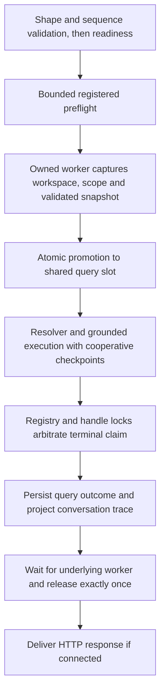

# Workspace conversation lifecycle corrective

**Draft for independent review.** The application base is
`f2dd2bda1890fb86ddb055ef101c2e5e098eba43`, the reranker-initialization
integration line. Neither the batching feature from PR #3 nor the
Engineering test fix from PR #4 is included. The accepted design and
[unchanged-route baseline](https://github.com/cschrupp/offline-rag/tree/76fdf1984ad8b8a0c08893d74d75405f2f8d8625/docs/evidence/workspace-conversation-lifecycle)
remain on their reviewed branch.



The router validates prior-turn sequence and question before readiness.
The worker then checks the active workspace, captures revision and snapshot,
validates source scope, and checks snapshot backing before query admission.
It carries the prepared binding into execution without re-reading current
workspace state. Direct app-layer callers reuse the same preparation and
execution with their existing control semantics. Public payloads are
unchanged.

A bounded preflight is registered before borrowing publication resources.
Its limit uses the configured query concurrency, independently of the
query execution slots. Preflight contention can reject before workspace
or snapshot validation with `query_preflight_capacity_exhausted`; ordinary
query-slot exhaustion follows snapshot validation and keeps the existing
`query_capacity_exhausted` reason. Both use the canonical 503 envelope.
There is no additional queue. The registry condition lock serializes
preflight registration, promotion, drain, and terminal ownership. Promotion
converts the same live handle without an idle gap. Drain marks the registry
before signaling handles. Promotion and terminal claim explicitly check
that flag so they cannot win after drain starts even if individual signal
delivery is still pending. Ownership protects runtime-backed reads until
the worker returns. Both preparation and admitted execution use the
existing configured query deadline as their own cooperative budget.

The existing owned-worker helper watches disconnect. The workspace option
waits for the underlying future even when the transport is canceled
repeatedly. The route releases the handle in its finalizer. Timeout is 504
when deliverable. Disconnect keeps the existing no-invented-HTTP-status
contract, with the managed-style 204 branch when the request is already
gone. The managed endpoint does not select the new worker option.

The terminal claim is the ordering point immediately before constructing
and committing the successful grounded record. A disconnect, deadline
or drain winning before that claim enters the existing terminal error
trace path when a query trace was allocated. Earlier cancellation allocates
no grounded record. A winning success claim permits persistence and the
matching conversation projection after disconnect. Persistence failures
remain errors; a claim is permission to commit, not proof the write
succeeded. Clarification has its own claim and still writes only a
conversation trace. A citation enrichment or conversation persistence
failure can leave the earlier truthful grounded trace, while the HTTP
request fails without a fabricated conversation answer. Internal logs
distinguish terminal and transport outcomes using operation/trace IDs.
The deadline cannot interrupt a native forward or blocking provider call.

## Local verification

- Registry tests exercise bounded preflight, reversed admission/drain
  outcomes, resource protection through grace expiry, terminal ordering,
  and exact release. HTTP tests exercise stale snapshot precedence under
  overload, cancellation before grounded allocation and on both sides of
  the terminal claim, and failures after grounded completion.
- The bounded Uvicorn fixture uses the real routes, with fake resources
  and a synthetic published workspace. It confirms the abandoned worker
  keeps its slot through two independent 503 submissions. It verifies a
  managed query also competes for that slot, exercises cooperative
  deadline mapping, and holds work past Uvicorn transport grace without
  closing the scorer early. The expected canceled-ASGI-task log is
  retained. It is not a model or network-provider qualification.
- Existing conversation tests cover validation precedence, resolver and
  clarification, mutation during resolver, source scope and scientific
  provenance. Existing query failure tests cover grounded trace persistence.

Run the loopback evidence from the repository root:

```bash
PYTHONPATH=src timeout -k 3 65 python \
  docs/evidence/workspace-conversation-lifecycle-implementation/owned_loopback.py \
  /absolute/path/to/models/tokenizers/tiktoken
```

The initial implementation held the drain lock while signaling handles.
A broader regression exposed blocked readiness during that interval.
The final version restored signal delivery outside the registry lock and
checks the drain flag at promotion and terminal claim. An early loopback
run also logged an abandoned shield wrapper exception; the workspace
worker now waits on the original future without a second wrapper.
A stale-binding test initially read the wrong level of the canonical
error envelope; the final assertion checks the nested code.

## Release boundary

The workspace single-turn query and explicit action routes remain
synchronous and lack this ownership envelope. The managed route retains
its existing admission and cancellation semantics. This corrective does
not qualify any of those routes for this workload.

Stage 1 evidence remains unchanged. Resume Stage 2 only after independent
acceptance, clean disposition of baseline test failures, and separate
execution authority. Both arms must run the same corrected workspace
route and verified image with a frozen local provider fixture, copied
storage, bounded load and restoration reserve. Deployment, activation,
VM work, and merging remain unauthorized.

The final five-suite backend comparison recorded 100 passed and eight
failed. The same eight tests fail on the exact parent in the legacy 15F
suite due to mocks expecting old query-call signatures. The final
drain-readiness test passed. No legacy assertion was relaxed.
[Matched failure identities](PYTEST.txt) and [loopback output](LOOPBACK.txt)
are retained.
