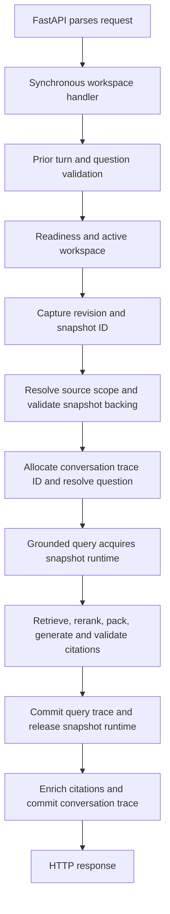
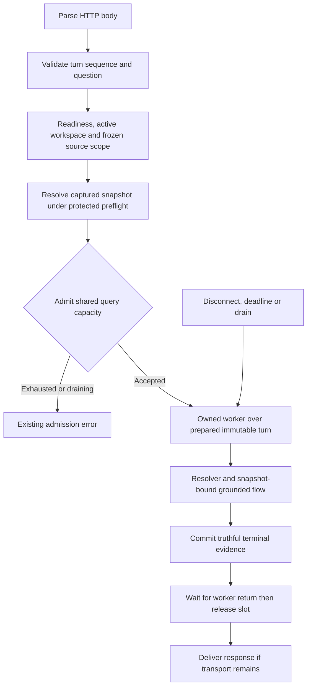

# Workspace conversation lifecycle reconciliation

Design for independent review. Application source stays at the accepted
Stage 2 preflight lineage. The reproduced baseline uses the unchanged
workspace conversation handler on a real loopback Uvicorn server.

## Current path

| Boundary | Source | Ownership |
| --- | --- | --- |
| Request shape and transport | `api/workspaces.py::workspace_conversation_turn` | FastAPI/ASGI. Synchronous handler passes no operation handle |
| A2-D05b and binding | `app/conversation/turn.py::run_conversation_turn` | Prior turns/question before readiness, then workspace, captured revision/snapshot, logical scope, scientific backing. No operation registry ownership |
| Resolver and trace | `app/conversation/turn.py` | Binding precedes resolver. Clarification persists conversation trace without a query trace |
| Grounded execution | `app/query.py::run_bound_snapshot_query`, `generation/orchestrate.py` | Snapshot runtime lease protects query resources during invocation. This lease is distinct from admission, transport cancellation and registry ownership |
| Terminal publication | `app/query.py`, `app/conversation/turn.py` | Query trace commits before workspace citation projection and conversation trace. Transport delivery follows both |
| Drain | `app/runtime.py::begin_drain`, `drain_async`, `finalize_shutdown` | Registry closes admissions, signals tracked workers and waits before resource closure. Workspace turn is invisible to that registry |
| Managed comparator | `api/query.py::product_query`, `api/workers.py::run_owned_worker`, `app/operations.py` | Managed product query holds the shared query gate through actual thread completion, watches disconnect and checks deadlines cooperatively |

The workspace route has no server-side cooperative deadline today.
Uvicorn waiting for an ordinary in-flight response in the baseline does
not establish application-owned drain or safety following grace expiry.
The client may leave before grounded execution and trace commits complete.

## Proposed path and compatibility decisions

Split preparation from execution and retain the app-layer entry point for
existing direct callers. Preparation has no provider/model work and
allocates no trace. Preserve request and error order through the snapshot
backing check. Invalid inputs, unready runtime, unknown workspace,
invalid scope and incompatible snapshot produce their existing errors
before the new capacity outcome. Validate each once. Carry the captured
workspace record, admitted revision, scope and resolved snapshot into
execution. Never re-read the current workspace to upgrade the binding.

Run blocking preflight off the event loop. A preflight that borrows
runtime-backed publication resources must be non-abandonable and protected
from concurrent resource finalization. Use a short registry-tracked
preflight guard with no query slot, or demonstrate equivalent existing
runtime ownership under all supported shutdown paths before omitting it.
Gate resource access on readiness after independent request validation.
On transition to owned execution, acquire the query slot while the guard
still protects the binding. Release the guard after admission or failure.
Keep drain/admission transition atomic with respect to the registry.
Review the boundedness of preflight and ensure waiting for this guard
honors existing grace accounting without closing borrowed resources.

Use `admit_query()` and `run_owned_worker()` with disconnect watching
for the prepared turn. Share the gate with managed `/v1/query`. Use the
existing exhausted/draining error envelope and status. At the default
capacity of one, reject competing valid turns while the slot is held.
No application queue. Use the existing query deadline from admission
and carry the same handle into resolver and grounded checkpoints.
Check before and after the resolver, before rerank/context, after context
before provider execution, and before result projection. An in-flight
native forward or blocking provider call can run until it returns.
The next checkpoint recognizes cancellation. Do not release capacity
on client EOF, timeout of an await, or shutdown grace expiry.

Treat terminal commit as a boundary. Before commit, cancellation must
not result in an answered trace. Retain existing grounded error-trace
behavior once its trace has begun. Before a grounded trace exists,
record cancellation in existing operation diagnostics, without
fabricating a grounded record. The conversation trace status enum has
no cancellation state. Preserve its current successful/clarification
schema and failure-path omission, with a correlated operation terminal
diagnostic for interrupted turns. Do not synthesize a clarification or
an answer for a canceled request. Once a successful terminal query
trace is committed, finish the bounded matching conversation projection
and commit exactly once even if the response can no longer be delivered.
Record transport loss separately. Preserve existing persistence-error
handling. Review the existing typed timeout, shutdown and disconnect
mapping before landing. Follow the managed route's no-invented-status
rule for disconnect. No request or response fields change.

Scope is the workspace conversation turn endpoint, reusable preparation,
ownership/checkpoint wiring and focused tests. The synchronous workspace
single-turn query and explicit action endpoints also lack managed turn
ownership. Actions can issue provider work but skip grounded reranking.
Audit both separately. Leave their paths, API and behavior outside this
corrective.

## Regression matrix

| Case | Baseline or existing coverage | Corrective gate |
| --- | --- | --- |
| Invalid prior sequence versus unready or saturated runtime | Existing A2-D05b validation tests | Existing request-invalid error wins, no resolver or slot |
| Valid request with invalid scope or stale snapshot under saturation | Existing scope and stale-binding tests | Existing validation error wins before busy |
| Normal and clarification | Loopback normal plus existing trace tests | One owned slot, exact grounded and conversation provenance. Clarification has no query trace |
| Competing request, including managed/workspace competition | Loopback both workspace callers entered at capacity one | Rejection on shared gate, no second provider or scorer entry |
| Disconnect before rerank | Planned controlled fixture | Next checkpoint stops before scorer, inspect trace and release timing |
| Disconnect during held scorer | Loopback abandoned and competing callers both reached held scorer and traces persisted | A separate third client gets busy while first worker is held after disconnect. It succeeds only after first worker returns and slot is released |
| Deadline during held scorer | Workspace baseline has no server deadline | Wall-clock client termination is independent. On release, next checkpoint rejects before generation, truthful terminal diagnostic, no premature release |
| Drain during held scorer | Bounded Uvicorn shutdown waited for release, registry count zero | Drain rejects admission and signals worker. Across grace expiry, no resource close until held worker returns |
| Preflight and drain race | Planned | No read against closed publication backing, no admission after drain, no leaked guard |
| Workspace mutation/deletion race | Existing resolver-mutation test | Frozen captured revision/source/snapshot only, retained resource ownership or existing backing error, never silently upgrade |
| Disconnect or error around trace commit | Planned | Exactly one terminal record per allocated query identity, no false success and no duplicate conversation record |

Use events at the provider or scorer seam for deterministic barriers.
Observe the real route over loopback for disconnect and graceful server
shutdown. Keep an outer process deadline and bounded fixture release.
Check admission from an independent HTTP client and verify trace files
after worker return. A cooperative deadline is not a hard inference
kill or a production latency guarantee.

## Updated Stage 2 and proposed next authority

Preserve Stage 1 outcomes. Recipes improved 44.15% paired median assembly
with exact parity. Rich passed parity, missed the performance screen
and retains the 45.731-second outlier.

After independent acceptance of the corrective, freeze the same exact
corrected application image for both arms. Vary only the existing
batching strategy. First prove the local regression matrix with synthetic
fixtures. Separately authorize the isolated four-vCPU campaign on copied
snapshot storage, with network disabled, scripted resource/deadline
limits and independent restoration reserve. Use the same Recipes and
Rich bindings, approved checkpoint, FP32 2/2 and frozen Qwen3 profile.
Use one serial, one two-client and one four-client wave per arm per
workload (28 submissions). Add four lifecycle cases per arm on the
workspace route (eight submissions). Total 36 maximum and zero retries.
Record offered/accepted/rejected counts, backend completion and HTTP
timings, trace/citation integrity, CPU, RSS and forward/assembly times.
Qualify workloads separately. Preserve all outliers. Managed product
query remains outside VM campaign scope unless separately approved.
Require original image, mounts, restart policy, health and publication
restoration before discarding scratch data.

Proposed authorization for review: implement only the workspace
conversation turn preparation and lifecycle correction above. Reuse
the existing query registry and worker. Add the specified deterministic
and bounded loopback regressions, including cross-route capacity
competition, and submit a separate branch for independent review.
Authorize no model campaign, VM work, deployment, schema change,
batching activation or merge in that implementation tranche.
