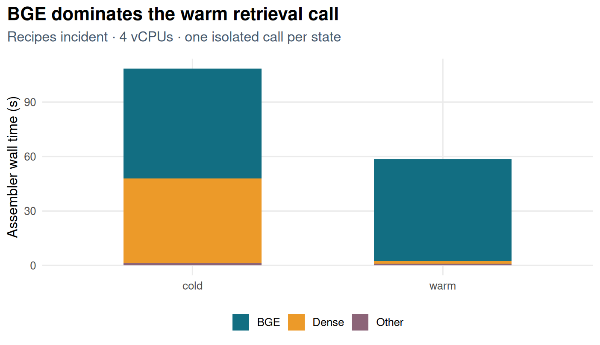
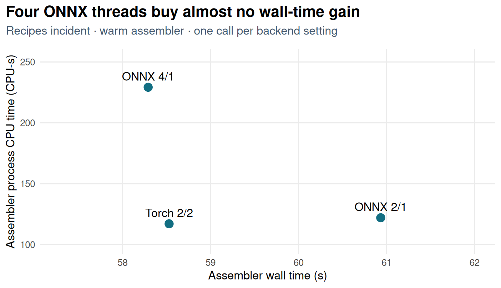
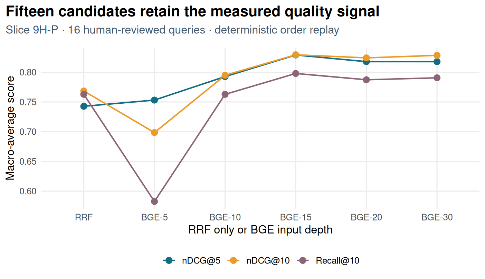
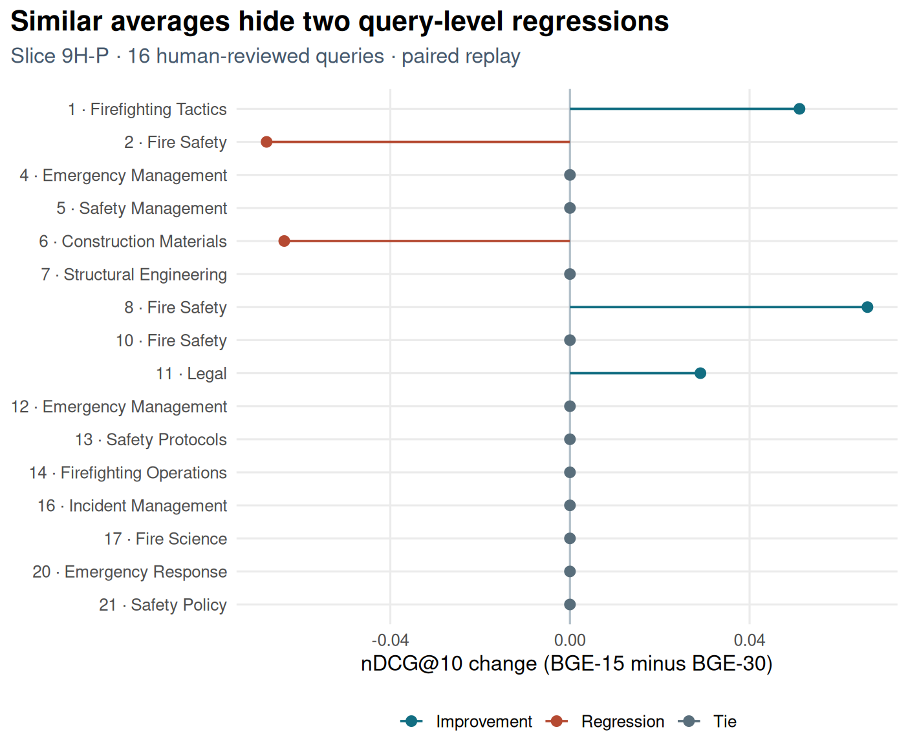
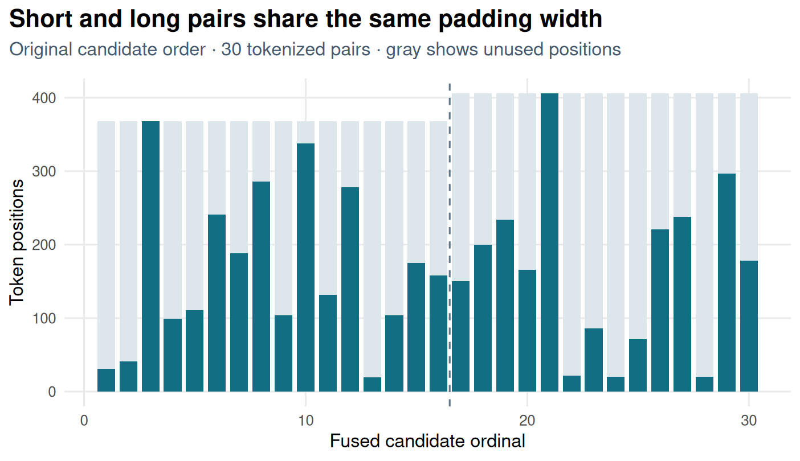
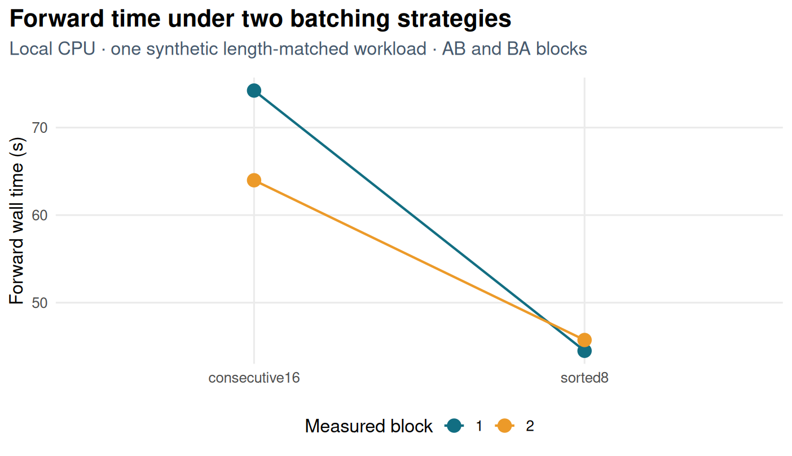
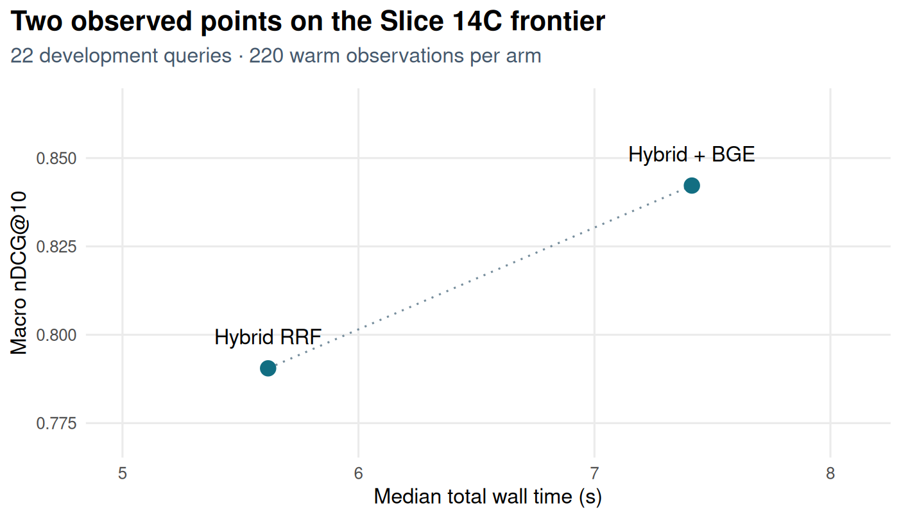
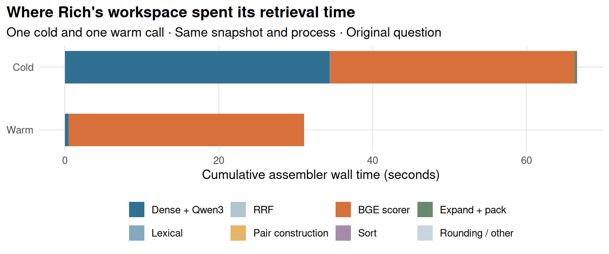
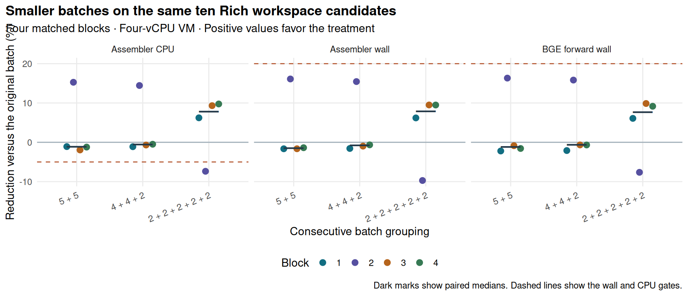
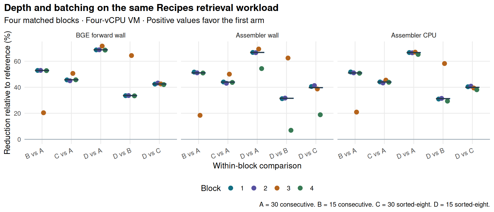

# The 59-Second Retrieval
## Finding the Quality–Latency Frontier in CPU-Only RAG

*An empirical investigation of candidate depth, length-aware batching, and the marginal value of neural reranking.*

**INTERIM RESEARCH REPORT · Seneca**

## Executive summary

A simple recipe question exposed a costly part of Seneca’s retrieval pipeline.
On the incident snapshot, a warm isolated run spent about 56 of 59 seconds
scoring 30 passages with a cross-encoder. Switching the same checkpoint to
ONNX FP32 preserved the selected evidence on that query, but yielded almost
no warm latency improvement on four vCPUs at the faster ONNX setting while
nearly doubling CPU time.

Two alternatives address the workload itself. A replay of 16 human-reviewed
development queries found that reranking the first 15 fused candidates
retained cohort-average nDCG@10 and Recall@10 relative to reranking 30.
Three queries improved, two regressed, and eleven tied on nDCG@10.
This exploratory result establishes neither query-level non-inferiority
nor production readiness.
Five and ten candidates missed the preregistered exploratory quality screen.
In the Recipes workload, sorting by token length and batching eight at a
time would remove 5,192 of the 6,590 padded token positions. A bounded
local synthetic pilot measured a 34.3% median paired reduction in forward
wall time with exact rank parity. The original incident passages and
evidence packing were outside that pilot.

The quality and cost evidence come from distinct populations and cannot
establish a common frontier for the new depths. Keep the current production
policy and prioritize an exact-incident batching replication followed by
a same-population quality and timing comparison of depths 15, 20, and 30.

## 1. The 59-second question

The browser displayed “Could not reach Seneca” after a user asked for the
ingredients in a baked French-fries recipe. The selected PDF belonged to a
published snapshot of 603 searchable passages. The server remained ready
after the incident. The prior incident investigation reported ten traces
ending in `model_abstain`, with context assembly taking 80.2–126.1 seconds
and generation 0.6–3.9 seconds. The trace counts do not identify the client
submission mechanism or establish automatic retries.

The title refers to the isolated warm retrieval measurement, separate from
the HTTP attempts and their generation outcomes. The first cold/warm study
found 99.392 and 58.756 seconds respectively. Warm dense retrieval took
1.903 seconds and BGE took 55.756 seconds (94.9% of assembly).

## 2. Following the evidence

A subsequent forward-pass diagnostic measured 59.224 seconds warm, of
which BGE consumed 56.672 seconds. The two model forwards used 56.651
seconds. Pair tokenization took about 20 ms and cold BGE load or wait about
1.18 seconds. The 129.639-second cold run spent 45.530 seconds in dense
retrieval and 82.316 seconds in BGE. First-use dense work mattered, and the
forward computation remained substantial after warm-up.

*Figure 1. Four-vCPU qualification run, PyTorch 2/2, one cold and one warm
call on the Recipes snapshot. Other comprises the remaining assembler work.*

The Torch thread experiment is a caution about single observations. Its
warm 2/2 baseline took 74.494 seconds in BGE, versus 56.753 at 2/1 and
54.417 at 4/1. The earlier independently observed 2/2 scorer took 56.672
seconds. The 2/1 result matched all logits in its experiment. The 4/1
result changed logits and failed that experiment’s exact-logit criterion
despite unchanged ranks and selected evidence. The cause of the unusually
slow baseline batch was unresolved.

Conventional CPU tuning left the same 30 pairs and the same padded
tensors to score. Torch's apparent thread-setting gain largely disappeared
against the earlier baseline. ONNX changed the execution engine, but on
the four-vCPU VM its 4/1 run used 229.22 CPU-seconds for warm assembly
versus 117.09 for Torch, with only 0.238 seconds wall-time difference.
This makes lowering padded work a more direct target for this incident.

The later ONNX study used its own declared numerical tolerance. Both ONNX
settings passed exact ranking, anchor, evidence and packed-context parity,
including one observed near tie. The maximum absolute score difference was
1.19e-5. The local synthetic feasibility study had shown a wall-time gain at
8/1 versus PyTorch 2/2 on a 16-logical-CPU host, with a larger CPU budget.
That result did not transfer to the four-vCPU deployment:

| Runtime | Cold/warm BGE (s) | Cold/warm assembly (s) | Warm assembler (CPU-s) | Peak process RSS (GiB) |
|---|---:|---:|---:|---:|
| Torch 2/2 | 60.661 / 56.132 | 108.507 / 58.529 | 117.09 | 4.21 |
| ONNX 2/1 | 65.375 / 59.211 | 76.925 / 60.934 | 122.05 | 4.73 |
| ONNX 4/1 | 60.597 / 56.184 | 72.084 / 58.291 | 229.22 | 4.73 |

*Table 1. Same snapshot and query, one cold and warm call per backend. The
ONNX arms’ shorter cold totals coincided with shorter dense retrieval in
the sequential first-use runs.*

*Figure 2. Warm process CPU-seconds versus wall seconds. The 4/1 arm
averaged 3.93 effective cores across assembly.*

## 3. Reframing the problem

Corpus search produces candidates. Reciprocal rank fusion (RRF) combines
dense and lexical rankings by summing reciprocal rank terms of the form
1/(constant + rank). BGE then reads each query–passage pair jointly and
emits a scalar logit. Once the candidate list is full, the size of the
source corpus tells us little about the cross-encoder’s forward workload.
The two practical levers are the number of pairs entering BGE and the
batch width required by their token lengths. [Original RRF paper](https://cormack.uwaterloo.ca/cormack/cormacksigir09-rrf.pdf) · [Passage Re-ranking with BERT](https://arxiv.org/abs/1901.04085)

Depth reduction can remove judged positives before scoring. It can also
exclude a distractor that BGE previously promoted above a positive.
Length grouping keeps the candidate set and changes tensor shapes. It can
alter floating-point logits, so restoring original score association and
checking ranking and evidence remain necessary.

## 4. Experimental methodology

The [preregistered protocol](RESEARCH_PLAN.md) fixes hypotheses, nulls,
endpoints, tolerances, and exploratory screens. The research branch starts
at deployed source `9c92e706c4b9e9d9ac0816a655bdf131cc63fca1`. ONNX
qualification `1d1f9aec`, thread diagnostic `9066e62f`, and instrumentation
`c3b72ac7` are evidence subjects with separate histories.

| Asset | Admissible use | Limitation |
|---|---|---|
| Slice 9 retrieval validation fixture | Verify harness semantics | Synthetic fixture excluded from relevance analysis |
| Slice 9H-P RRF/BGE-30 and matching GoldDataset v1 | Prefix replay on 16 human-reviewed primary cases, with 6 assistant-only cases for sensitivity | 22 development queries in `ics_modules`, no raw BGE logits in these results |
| Corrected Slice 14C | Historical two-arm paired quality and measured latency | 44 variant-cases, 440 measured observations, 88 warm-ups, zero failures or exclusions. Saved ranks are top 10, insufficient for independent prefix replay |
| Recipes incident and isolated VM diagnostics | Stage, CPU, padding and backend comparisons | One query, no verified Gold labels or locally available original passage payload |
| Level-C and Slice 10E | Generation boundary and evaluation design | Different objectives and populations, no paired depth treatment |

The Gold dataset, corpus, chunk set and historical input hashes appear in
[observations.json](data/observations.json). The human-reviewed cohort
contains 102 positive judgments across 16 cases. The assistant-only cohort
has 18 across six. The frozen legacy results and adjudication map retain
their original dispositions. In particular, human review here is development
provenance and does not establish a publication-grade independent benchmark.

For each replay, the first *k* candidates came from the original fused order.
The 30 BGE output IDs formed a complete permutation of those same inputs on
all 22 cases. Filtering that permutation by prefix membership is equivalent
to sorting the prefix by its retained score order and tie-break. It does not
establish numerical parity for a fresh forward pass at a different batch shape.
The score replay therefore reports neither seconds saved nor evidence-unit
parity. Top-five candidate overlap is reported separately.

Recall@k divides retrieved judged positives by known positives. Precision@k
divides by the smaller of the returned list length and the cutoff. A
five-result arm therefore has the same Precision@5 and Precision@10.
HitRate@k records whether any positive is present and MRR averages reciprocal
first-positive ranks. Seneca nDCG uses graded gains and logarithmic discounts
relative to an ideal ordering from the Gold judgments. It does not establish
exhaustive relevance outside the judged pool. The analysis calls the canonical
Slice 9 metric implementation directly. The descriptive bootstrap resamples
paired queries, not individual timing repetitions. [Cumulated Gain-Based Evaluation of IR Techniques](https://www.fi.muni.cz/~xkohout7/Research/clanky_cizi/evaluation/p422-jarvelin.pdf)

## 5. Experimental results

### Candidate depth

| Treatment | nDCG@5 | nDCG@10 | Recall@5 | Recall@10 | MRR | Mean top-five overlap with BGE-30 |
|---|---:|---:|---:|---:|---:|---:|
| RRF | .743 | .768 | .583 | .763 | .875 | 3.31 |
| BGE-5 | .753 | .698 | .583 | .583 | .906 | 3.31 |
| BGE-10 | .793 | .795 | .654 | .763 | .906 | 4.44 |
| BGE-15 | .829 | .829 | .683 | .798 | .906 | 4.81 |
| BGE-20 | .818 | .824 | .663 | .787 | .906 | 5.00 |
| BGE-30 | .818 | .828 | .663 | .790 | .906 | 5.00 |

*Table 2. Canonical metrics on the same 16 human-reviewed queries at each
depth. HitRate@5 was 1.0 throughout, leaving that endpoint unable to
discriminate the arms. Precision and all cohort results are in the data.*

*Figure 3. Depth replay on 16 human-reviewed development queries. Similar
cohort averages do not establish query-level non-inferiority or deployment
readiness. Depth-specific latency was not measured.*

BGE-15 and BGE-20 passed the exploratory mean-loss screen. The BGE-15
paired nDCG@10 change relative to BGE-30 was +.0010 with descriptive 95%
bootstrap interval [−.0159, +.0158]. The BGE-10 change was −.0335 and it
missed the nDCG margin. BGE-5 also lost Recall@10. BGE-15 retained 81.6%
of known positives across its entire returned list, versus 88.9% at
depth 30, even though its Recall@10 was slightly higher. The 22-case
sensitivity run ranked BGE-15 at .847 nDCG@10 versus .842 for BGE-30.
The six assistant-only cases yielded .894 versus .879 and cannot resolve
uncertainty in the human-reviewed stratum.

*Figure 7. BGE-15 minus BGE-30 nDCG@10 for each human-reviewed query.
Positive values favor BGE-15. Zero means a metric tie, even if lists differ.*

The five nonzero changes show how the cohort mean can conceal individual
losses. These are case-level scores. Fire Safety appears twice with opposite
outcomes, so its regression cannot be generalized to the category.

| Case ordinal | Category | Paired nDCG@10 change |
|---:|---|---:|
| 1 | Firefighting Tactics | +0.0511 |
| 2 | Fire Safety | −0.0676 |
| 6 | Construction Materials | −0.0636 |
| 8 | Fire Safety | +0.0663 |
| 11 | Legal | +0.0291 |

Eleven cases tied, three improved and two regressed. The full input pool
contained **64 judged-positive query–passage matches at depth 15 versus
79 at depth 30**, across 102 known positives in the cohort. These are summed
counts before applying the top-ten cutoff. Recall@10 is a macro-average of
per-query fractions restricted to the first ten results after reranking.
A shorter input pool can lose judged positives overall while moving more
of the retained positives into the top ten on some queries. This replay
does not establish whether such a change improves grounded answers.

### Padding and forward cost

*Figure 4. Observed lengths in the original 30-pair order. Gray shows
padding to the maximum width within each consecutive batch.*

| Batch plan | Batches | Padded positions | Padding fraction | Squared-width proxy |
|---|---:|---:|---:|---:|
| Consecutive 16+14 | 2 | 6,590 | 56.95% | 4,474,488 |
| Sorted 16 | 2 | 3,358 | 40.26% | 2,748,600 |
| Sorted 8 | 4 | 1,398 | 21.91% | 1,733,280 |
| Sorted 4 | 8 | 486 | 8.89% | 1,370,000 |
| Sorted 2 | 15 | 184 | 3.56% | 1,257,102 |

*Table 3. Arithmetic projections from 4,982 active token positions.
Padded positions are the sum of batch size × batch width minus active
positions. The proxy sums batch size × squared batch width. It excludes
feed-forward layers, batching overhead, and kernel efficiency.*

*Figure 5. Two measured, counterordered blocks on an Intel i9-10885H,
PyTorch FP32 2/2, following one warm-up per strategy. The model saw
synthetic pairs with the same 30 tokenized lengths as the incident.*

| Measured block | Consecutive forward (s) | Sorted-8 forward (s) | Reduction | Consecutive / sorted-8 (CPU-s) |
|---|---:|---:|---:|---:|
| 1 | 74.224 | 44.501 | 40.0% | 150.56 / 89.44 |
| 2 | 63.981 | 45.736 | 28.5% | 130.13 / 91.93 |

*Table 4. Forward times are sums of individual batch timings.
CPU time includes all process threads during those forward calls.*

The projection removes 5,192 padded slots, about 79% of the original
padding, and reduces the squared-width proxy by 61.3%. Neither percentage
estimates wall time. The measured synthetic median forward reduction was
34.3%, above the 20% local pilot screen.
Every pair had identical unpadded IDs across arms, and both blocks passed
the predefined logit tolerance with a maximum difference of 1.76e-5.
After restoring original score association, all 30 ranks matched. Evidence
selection is unevaluable on this synthetic input. The local pilot provides
a measured reason to replicate length grouping on the original snapshot.
It does not establish the incident or deployment latency reduction.

### The observed frontier

*Figure 6. Same-suite Slice 14C points. Quality uses 22 development cases.
Each median uses 220 valid warm observations per arm. The dotted line
connects the two known configurations and does not imply interpolation.*

The accepted 14C medians were 5.617 s for hybrid and 7.413 s for hybrid
plus BGE, at macro nDCG@10 of .791 and .842 respectively. The p95 rose
from 8.312 to 13.533 s. Both points are nondominated among the two observed
arms. The historical 62.455 s rerank maximum remains in the evidence.
The 9H-P replay and the Recipes timings cannot put a measured BGE-15 point
on this chart. There is no measured adaptive-depth frontier.

## 6. What the model earns

Compared with RRF alone, BGE-30 improved nDCG@10 on 7 human-reviewed
queries, worsened it on 6, and tied on 3. The macro gain was +.060, with
large positive changes concentrated in a few cases. For example, one
emergency response case rose by .565 and a structural engineering case
rose by .268. A construction materials case fell by .036. These examples
refer to recorded metric changes and omit source and query text.
Most categories have one or two cases, so category-specific depth rules
would overfit this sample.

The Recipes run packed five evidence units into 645 tokens. The retained
research materials establish identical packing between tested backends, but
do not establish that the requested ingredients appeared in the retrieved
passages, moved up after BGE, or were sufficiently represented in the
packed context. `model_abstain` identifies a recorded generation outcome.
It does not establish the cause of the abstention. Determining that cause
would require a source-bound evidence audit and, for a causal comparison,
paired answer evaluation with an independently judged endpoint.

Level-C supplies a separate operational example: 20 of 25 measured
attempts answered, while five were parse failures on one repeated case
that reached the output ceiling. That is a generation-path finding on a
different population and does not explain Recipes. Slice 10E provides the
accepted distinction between evidence sufficiency and generator behavior.
Neither dataset establishes that better ranking would improve the original
answer or prevent its abstention.

## 7. Engineering implications

On the four-vCPU VM, ONNX 4/1 saturated nearly the full CPU allocation on
a single request and added about .52 GiB to process peak RSS plus a
2.12 GiB model bundle. It provided no useful warm wall gain. Resource
testing for any new candidate should account for the concurrent Qwen3
session, Docker memory limits, and multiple overlapping requests.
This study measured isolated latency rather than request capacity.

Length sorting is a reversible scorer experiment: keep the original 30
pairs, regroup by measured length, and restore the original score
association before canonical ranking. A candidate-depth policy needs
stronger evidence because it changes which passages BGE can see.
A dynamic policy would also need to justify its features and evaluate a
frozen policy on an independent population before considering rollout.
No production defaults or scientific contracts changed.

## 8. Conclusion and next decisions

BGE forward computation explains most of the 59-second warm run. Backend
substitution at the tested settings did not solve that CPU workload.
Length grouping reduces padded work on the incident shape. Fifteen and
twenty candidates preserved the exploratory quality screen on the
human-reviewed fixture. The study provides no causal estimate of answer
benefit and no qualification for a production depth or batching change.

The next controlled execution requires separate VM authority or an
approved local snapshot export. Run the original 30-pair incident workload
with consecutive 16+14 and sorted eight, one warm-up per arm and at least
three paired measured blocks with alternating order, fixed Torch 2/2
and no generation. Record actual per-batch forward wall/CPU time, peak
RSS, encoded input and position parity, raw logits, rank, selected evidence
and packed text identity. Follow with same-host trials at depth 15, 20 and
30 on a separately adjudicated population, including longer passages and
multiple query categories. Measure the cost and relevance of each arm
on that same population before selecting a frontier or training an
adaptive policy.

See [reproducibility instructions](REPRODUCIBILITY.md), [authorization](evidence/study/AUTHORIZATION.md),
and the [protocol](RESEARCH_PLAN.md).

[Independent review status](evidence/REVIEW_STATUS.md)

## 9. Exact-incident batching on four vCPUs

This follow-up uses the accepted interim revision as its baseline. The
original experiment found a CPU bottleneck in transformer forward passes.
The padding projection and local synthetic pilot pointed to a way to reduce
that work while retaining every candidate. The four-vCPU comparison tests
that mechanism on the original Recipes question and selected document.

The experiment ran against an isolated copy of Recipes revision 4.
Both arms used the deployed image, the approved PyTorch FP32 BGE checkpoint,
two intra-op and two inter-op threads, the canonical Qwen3 CPU profile,
30 RRF candidates, passage-only truncation and a 1,024-token ceiling.
Arm A used the deployed consecutive 16+14 shape. Arm B performed a timed
length prepass, stably sorted by tokenized length and original ordinal,
and scored 8+8+8+6. It restored score association before the canonical
sort and context packer. A/B warm-up was followed by measured blocks
A/B, B/A, A/B in one isolated process.

The preregistered gates required every logit delta to satisfy
`abs(B-A) <= 1e-4 + 1e-5 * abs(A)`, exact candidate and evidence parity,
and median paired reductions of at least 20% in both forward and assembler
wall time. The [protocol and execution evidence](evidence/exact-incident-batching/PROTOCOL.md)
record the exact safeguards and instrumentation.

**Result.** Both preregistered performance thresholds and all four parity
comparisons passed. Median paired warm forward wall time fell **48.6%**,
assembler wall time fell **46.8%**, and forward process CPU time fell
**48.5%**. The original synthetic pilot measured a **34.3%** median paired
forward reduction on its separate host and workload.

| Block and arm | Assembler (s) | BGE forward (s) | Forward by batch (s) | Forward CPU-s | Padded positions | End RSS (MiB) |
|---|---:|---:|---|---:|---:|---:|
| 0 A | 115.957 | 63.535 | 32.657 + 30.878 | 124.83 | 6,590 | 3913.2 |
| 0 B | 36.816 | 34.639 | 3.626 + 7.130 + 10.370 + 13.514 | 69.26 | 1,398 | 3924.8 |
| 1 A | 64.020 | 62.025 | 31.148 + 30.877 | 124.01 | 6,590 | 3925.0 |
| 1 B | 36.370 | 34.404 | 3.626 + 7.045 + 10.248 + 13.485 | 68.79 | 1,398 | 3925.4 |
| 2 B | 36.550 | 34.264 | 3.623 + 6.971 + 10.239 + 13.431 | 68.51 | 1,398 | 3925.5 |
| 2 A | 68.707 | 66.698 | 30.993 + 35.704 | 133.06 | 6,590 | 3925.4 |
| 3 A | 80.409 | 76.661 | 43.344 + 33.317 | 151.70 | 6,590 | 3922.8 |
| 3 B | 37.949 | 35.485 | 3.725 + 7.211 + 10.559 + 13.990 | 70.62 | 1,398 | 3924.6 |

Block 0 was warm-up and is excluded from the performance gate. The three
measured forward reductions were **44.5%, 48.6%, and 53.7%** in paired
order. Assembler reductions were **43.2%, 46.8%, and 52.8%**. Arm A forward
time varied from 62.025 to 76.661 s. B ranged from 34.264 to 35.485 s.
The ordering and all observations are retained because a single percentage
would hide that variation. The 20% threshold was exceeded in every measured
pair on both wall endpoints.

Observed batch widths were 368 and 406 in A, and 86, 166, 241 and 406 in B.
Both arms processed the same 4,982 active token positions. B removed 5,192
padded positions, about 79% of A's padding. The reduction in process CPU
time shows that this workload performed less compute, alongside reduced
wall time at the same thread setting. End-of-call RSS stayed close to
3.83 GiB for both arms. The shared process high-water RSS was 4.24 GiB and
cannot isolate an arm-specific peak. The lowest sampled host available
memory after an observed call was 10.15 GiB.

The largest absolute raw-logit delta was **3.81e-6**. For every pair, the
ordered candidate IDs, candidate-aligned active inputs and positions,
full ranked IDs, selected anchors, all five evidence units, and the
645-token packed context matched. The raw record associates each signed
logit difference with its original fused ordinal. A changed ranking or
packed context would have prevented a pass even within logit tolerance.
The experiment evaluated scientific output identity on this query and
did not invoke generation or evaluate answer quality.

**Engineering decision.** Advance sorted-eight batching to independent
technical review as a candidate for broader qualification. Keep the
deployed defaults. Three pairs on one query in a shared warm process
cannot establish performance on diverse cohorts, concurrent loads, or
production p95. Before integration, require a representative multi-query
comparison of candidate, rank and evidence parity, including near ties,
and measure latency and resource use under concurrency. This experiment
neither validates reduced candidate depth nor expands the accepted
quality–latency frontier for that question.

See the [full measurement record](evidence/exact-incident-batching/MEASUREMENTS.log),
[derived summary](evidence/exact-incident-batching/SUMMARY.json), and
[execution and restoration record](evidence/exact-incident-batching/EXECUTION.md).

## 10. Rich's workspace — a small pool with expensive pairs

A single 58 KiB PDF produced ten eligible passages. The warm isolated
assembler scored all ten in one 10 × 509 tensor batch. At 30.592 seconds,
the BGE forward pass accounted for nearly all of the 30.615-second scorer
interval. Dense search took 0.465 seconds within the 31.108-second total.
The forward pass still processes thousands of input positions across
every transformer layer even when the corpus contains only ten passages.

| Stage or observation | Cold | Warm |
|---|---:|---:|
| Dense retrieval including Qwen3 | 34.422 s | 0.465 s |
| Lexical retrieval | 0.029 s | 0.016 s |
| BGE scorer | 31.787 s | 30.615 s |
| BGE forward within scorer | 30.357 s | 30.592 s |
| Context expansion and packing | 0.334 s | 0.009 s |
| Assembler total | **66.576 s** | **31.108 s** |
| Process CPU time | 93.95 CPU-s | 63.31 CPU-s |

*Figure 8. Two assembler calls on one four-vCPU VM process. The waterfall
uses the nonoverlapping leaf stages with rounding and unclassified time
retained. BGE forward is already included in the scorer segment. The raw
timers, resource samples, and reproducible figure inputs are retained
with the stage-attribution record.*

The 33.957-second dense cold/warm gap captures first-use Qwen3 and dense
retrieval costs together. The trace does not separate Qwen3 initialization
from artifact I/O and other dense activity. BGE first-use load or wait took
1.327 seconds and its forward duration remained near 30.5 seconds warm.
A startup-warming intervention could address the cold component and would
leave the warm forward work in place.

The browser's 46.095-second HTTP 200 and cited rendering establish that
end-to-end delivery worked on that attempt. They leave earlier intermittent
transport failures unresolved. Its 39.775-second context stage used a
different resolver-derived retrieval question, as shown by the linked
query and conversation hashes. The stage-attribution run used the original
question without history. It is a same-snapshot related workload.
The cold and warm diagnostic calls had identical full rankings, logits,
anchors, three evidence units and 3,729 packed tokens.

Recipes had 30 pairs and roughly 57% padding in two consecutive batches,
and sorted-eight measurably reduced forward cost on that query. Rich's
single batch had 624 padded positions out of 5,090 (12.3%). Most of its
pairs approach the 509-token batch maximum. Candidate count, individual
lengths, and batch maxima jointly determine padded tensor size. Fewer
pairs can still be expensive when most of them are long.

### A bounded comparison of consecutive batch shapes

| Consecutive grouping | Batch widths | Total positions | Padding positions | Squared-width proxy |
|---|---|---:|---:|---:|
| 10 | 509 | 5,090 | 624 | 2,590,810 |
| 5 + 5 | 509, 508 | 5,085 | 619 | 2,585,725 |
| 4 + 4 + 2 | 509, 508, 499 | 5,066 | 600 | 2,566,582 |
| 2 + 2 + 2 + 2 + 2 | 509, 477, 329, 508, 499 | 4,644 | 178 | 2,203,832 |

These are arithmetic projections from the original ordered lengths. Only
the first grouping has timing evidence on Rich's exact pairs. Five
forward calls at batch size two trade lower padding for more sequential
calls and potentially different kernel efficiency. The
[proposed protocol](evidence/small-pool-design/PROTOCOL.md) freezes
model, inputs, CPU budget, grouping order, warm-up, four counterbalanced
blocks and the performance and parity gates. It makes no latency prediction.

### Marginal relevance at equal candidate depth

The retained Slice 9H-P artifacts permit a matched comparison of RRF and
BGE on the same original prefix. The following uses the 16 human-reviewed
development cases and the canonical graded metrics. At each depth, the
BGE order is the restriction of the retained 30-candidate permutation to
the original RRF prefix. These cases were retrospectively capped. They
do not represent naturally small corpora or a newly timed small-batch pass.
Six assistant-only cases are available as a separate sensitivity cohort.

| Pool depth | RRF → BGE nDCG@5 | RRF → BGE Recall@5 | Improves / regresses / ties on nDCG@5 | Top-five membership changes | Membership changes with all four judged endpoints tied |
|---|---:|---:|---:|---:|---:|
| 5 | .743 → .753 | .583 → .583 | 3 / 4 / 9 | 0 | 0 |
| 10 | .743 → .793 | .583 → .654 | 6 / 4 / 6 | 14 | 5 |
| 15 | .743 → .829 | .583 → .683 | 6 / 4 / 6 | 15 | 5 |
| 20 | .743 → .818 | .583 → .663 | 5 / 5 / 6 | 15 | 5 |

At depth five reranking can change position without changing membership.
At depth ten, 14 cases changed membership and nine of those showed
no nDCG@5 gain. Five of those swaps tied on nDCG@5, Recall@5,
Precision@5 and HitRate@5. A tied metric can hide meaningful evidence
differences. These artifacts capture passage ranks, not downstream
context assembly under both policies. They cannot establish that the
selected evidence or packed text changed or that those changes would
affect the answer. Fire Safety improved on two of three depth-ten cases.
Emergency Management regressed on both of two. The categories are too
small to support category-level routing or generalization.

On Rich's diagnostic, the ordered input and full ranked ID digests
differ, which establishes that BGE changed ordering. The retained
diagnostic does not expose which passages moved, an RRF-only packed
context, or independent Rich relevance labels. Scope identity and
BGE agreement cannot substitute for that evidence. See the
[matched-prefix data](data/small-pool-replay.json) and
[quality-gated policy proposal](evidence/small-pool-design/QUALITY_POLICY.md).

### Architecture choices and order of work

| Treatment | Mechanism | Scientific risk and implementation cost | Memory and Docker implications | Evidence required |
|---|---|---|---|---|
| Optimize current BGE batching | Change tensor widths and kernel shapes, keep all pairs | Lower risk, bounded scorer change. FP32 accumulation can still change rank near ties | Same checkpoint and runtime. Smaller activation tensors and more calls may trade off. Measure peak RSS, including co-resident Qwen3 | Approved exact-pair comparison, selected evidence parity, representative workloads and concurrency |
| Quality-qualified RRF-only | Skip classifier execution for an explicitly eligible path | Higher relevance risk. Moderate policy and validation work. Rank and evidence can change even in one document | Lower reranker memory only if model is never loaded, or safely released with a separate lifecycle policy. Mixed paths may still retain it | Blinded paired judging, conservative per-stratum gates, identical scope and context contract, CPU/wall cost |
| Smaller multilingual reranker | Reduce model compute and activation size | High scientific risk, new checkpoint and adapter qualification, multilingual/technical drift | Potentially smaller weight and RAM footprint, which must be measured. Requires new provisioned bundle and compatible Docker runtime | Multi-domain and multilingual retrieval quality, calibration/rank and evidence outcomes, offline artifact verification |
| Quantization or alternate representation | Use lower-precision kernels or a different execution engine | Medium to high risk, separate format export, parity and scientific review. Near ties can flip | Quantization may shrink weights but calibration, buffers and runtime can offset savings. FP32 ONNX previously added a sidecar and RSS without a meaningful four-vCPU gain on Recipes | Hash-bound artifacts, raw score/order and evidence gates where applicable, measured CPU-seconds, RSS and throughput |
| Faster inference hardware | Increase compute or memory bandwidth with the same pipeline | Low risk for equivalent supported execution, rising if backend or precision changes. Higher operational cost | Larger CPU allocation or accelerator-aware Docker and driver provisioning. Measure contention and footprint, verify supported profile | Equal-workload comparison, exact rank/evidence parity, capacity and cost checks |

First qualify the proposed grouping comparison on these ten pairs with
separate execution authority. In parallel with a later approved label
collection, build a held-out set of naturally small pools and test the
RRF-only quality gate. If neither approach improves the tradeoff, compare
hardware at matched scientific settings before taking on a new model or
representation. The accepted Recipes batching and ONNX findings retain
their original scope. No new inference or production change was executed.

[Rich stage attribution and provenance](evidence/rich-stage/REPORT.md) ·
[Reproduction instructions](evidence/small-pool-design/REPRODUCE.md)

## 11. BGE-15 qualification — publication boundary and open performance gate

Reducing `reranker.input_k` changes the candidate pool **before** raw-logit
scoring. It changes `reranker_config_hash`, which is part of the immutable
snapshot manifest. The ordinary registry rejects BGE-30 snapshots under
BGE-15 settings with `reranker_config_stale`, and vice versa. Flipping a
global setting would leave existing workspace bindings stale.

The canonical publisher can validate a new manifest against the same
dense and lexical backing without ingesting again. The isolated BGE-15
publication must keep source, chunk, dense and lexical identity, and use
matching settings with depth 15, output_k 10 and the existing anchor_k 5.
An offline fixture using the deployed registry, a real local lexical
fixture and a fake Qdrant backend verified distinct snapshot IDs, reuse
of the same index identities, both mismatched-config rejections, and
restoration of the original corpus pointer. Real Recipes backing is
a remaining VM preflight check. [Publication and rollback plan](evidence/bge15-cpu/PUBLICATION.md)

### What the depth replay supports

| 16 human-reviewed development queries | BGE-30 | BGE-15 |
|---|---:|---:|
| Mean nDCG@5 | .8177 | .8289 |
| Mean nDCG@10 | .8283 | .8293 |
| Mean Recall@5 | .6633 | .6828 |
| Mean Recall@10 | .7905 | .7978 |
| Judged positives retained in full pools | 79 / 102 | 64 / 102 |

**Depth 15 regressed on two queries:** Fire Safety (−0.0676 nDCG@10)
and Construction Materials (−0.0636). Three queries improved and eleven
tied. Figure 7 shows the full distribution. Dropping 15 judged positives
from the full pools can coexist with slightly higher mean Recall@10.
The retained ranked lists show different top-five membership on 3 of 16
queries and do not establish the selected anchors, evidence units or
packed contexts a live BGE-15 run would produce. Development averages
do not establish query-level non-inferiority. The proposed independent
held-out gate includes paired nDCG/Recall margins and direct-evidence
and context-sufficiency protections. [Predeclared protocol](evidence/bge15-cpu/PROTOCOL.md)

### Four-vCPU timing remains pending

At preflight, the VM's remaining run time was about 26 minutes, below
the validated 30-minute minimum maintenance margin. No stop, copy,
publication write, or inference was attempted. The four-arm matrix
remains pending a sufficiently long VM window and validation of both
publications against the copied store.

| Comparison cell | Evidence available today |
|---|---|
| BGE-30, consecutive | Historical Recipes warm scorer about 56–57 s in prior diagnostics |
| BGE-15, consecutive | No four-vCPU measurements |
| BGE-30, sorted-eight | Historical exact-incident qualification, 48.6% median paired forward gain, section 9 |
| BGE-15, sorted-eight | No four-vCPU measurements |

No depth-15 wall time, CPU, memory, output parity or combined batching
benefit is inferred from the historical numbers. A later measured
four-arm run will hold the original fused order, dense and lexical
branch depths and scope fixed; depth 15 consumes its first 15 IDs.
The protocol compares four counterbalanced paired blocks, includes a
research performance screen, and keeps within-depth batching parity
separate from the quality consequences of reducing depth. Relevance
replay on Slice 9H-P and VM timing on Recipes cannot establish a measured
quality–latency frontier on one population.

**Disposition:** publication and experimental design ready for independent
review. Performance and production quality remain unevaluated. The current
runtime has a single settings profile, so mixed-depth workspaces would
require separately reviewed settings-aware binding, or isolation at the
deployment boundary. Migration and rollout design await both evidence
gates. Retain the original BGE-30 settings, manifests, indexes and bindings
for rollback.

## 12. Rich workspace — changing batch size on the same ten pairs

This experiment isolates consecutive batch grouping as the only treatment.
The prior Rich diagnostic showed a costly warm forward pass despite low
padding. The experiment kept the original snapshot, no-history question,
fused candidate order, tokenizer, BGE FP32 checkpoint and Torch 2/2 policy.
The Qwen3 CPU embedding profile remained fixed. The four groupings were
A: 10, B: 5+5, C: 4+4+2, and D: 2+2+2+2+2. This study did not sort the
pairs by length or reduce the reranker depth.

The accepted protocol specified four warm-ups and the measured schedules
A/B/D/C, B/C/A/D, C/D/B/A and D/A/C/B. Every measured treatment is compared
to the A call in its block. The unchanged gate requires median paired
forward and assembler wall reductions of at least 20%, at least three
positive pairs on both wall endpoints, no more than 5% median paired
assembler CPU increase, and exact scientific output within the prespecified
raw-logit tolerance. See the [accepted protocol](evidence/small-pool-design/PROTOCOL.md).

The first attempt's retained stream ended at 17 of 20 observations and
contained no restoration confirmation. The original deployment passed
preflight after the operator restarted the VM. The fresh complete schedule
writes evidence locally on the VM and is analyzed separately. Partial
timing observations from the earlier attempt are retained and excluded
from the complete paired comparison.

**Result: all three treatments passed scientific parity. None met the
performance advancement gate.** Batch size two yielded the largest observed
median gains: 7.6% forward wall, 7.8% assembler wall, and 7.8% assembler
CPU. It improved both wall endpoints in three of four blocks and still
fell short of the required 20% medians.

| Treatment | Median paired forward reduction | Median paired assembler reduction | Median paired assembler CPU reduction | Positive wall pairs (forward / assembler) | Parity | Advances |
|---|---:|---:|---:|---:|---|---|
| B · 5+5 | −1.2% | −1.5% | −1.2% | 1/4 · 1/4 | Pass | No |
| C · 4+4+2 | −0.7% | −0.8% | −0.6% | 1/4 · 1/4 | Pass | No |
| D · five batches of two | +7.6% | +7.8% | +7.8% | 3/4 · 3/4 | Pass | No |

*Figure 9. Each dot compares one measured treatment call against A in
the same block. Dark marks show paired medians. Positive values favor the
treatment. Dashed lines show the preregistered wall and CPU gates.*

| Measured block | A assembler (s) | B assembler (s) | C assembler (s) | D assembler (s) |
|---|---:|---:|---:|---:|
| 1 · A/B/D/C | 25.926 | 26.353 | 26.333 | 24.317 |
| 2 · B/C/A/D | 31.375 | 26.321 | 26.528 | 34.423 |
| 3 · C/D/B/A | 26.853 | 27.294 | 27.113 | 24.303 |
| 4 · D/A/C/B | 26.811 | 27.180 | 26.985 | 24.268 |

Block 2 matters. The A and D calls were slower than their counterparts
in other blocks, and D regressed 9.7% against A on assembly. The run does
not establish the cause of that variation. All four blocks are retained.
The earlier 31.108-second warm diagnostic remains a separate observation,
while the table uses only this run's matched references.

D reduced padding from 624 to 178 positions, a 71% reduction in padding
and an 8.8% reduction in total positions. It also changed one forward
call into five. That arithmetic is compatible with a modest measured
benefit here and does not predict the observed timing by itself.
B and C removed only 5 and 24 padded positions respectively. The
accepted large Recipes sorted-eight gain is a separate result from
another length distribution and a different grouping strategy.

All 15 arm-to-A checks passed, including the warm-up comparisons.
The maximum absolute raw-logit difference was 2.86e-6. Ordered
candidate identities, active model inputs, full ranks, anchors, all
three evidence units and the 3,729-token context matched. The raw log
retains batch widths, every per-batch timing, scorer and assembler
CPU, resource observations and bounded identity hashes for all 20 calls.
End RSS for measured calls was about 3.83 GiB in A and B, 3.88 GiB in C
and 3.89 GiB in D. Process high-water RSS reached 4.18 GiB across the
shared process. Sampled host available memory dipped to about 5.22 GiB
and recovered. The shared process and sampled measurements do not
identify arm-specific memory peaks or explain transient system behavior.

**Engineering decision.** Keep the existing consecutive grouping for this
workload. Smaller batches preserved scientific output but did not reach
the predeclared threshold. Keep the result scoped to one long-passage,
ten-pair query on four vCPUs. It does not determine p95, concurrent
capacity or a policy for other workloads. The BGE-15 experiment remains
separate and was not run here.

[All 20 trials and paired gates](evidence/rich-small-pool-execution/SUMMARY.json) ·
[Raw measurements](evidence/rich-small-pool-execution/MEASUREMENTS.log) ·
[Execution and restoration evidence](evidence/rich-small-pool-execution/EXECUTION.md)

## 13. Recipes — measuring the BGE-15 and batching interaction

The four-vCPU matrix pairs depth reduction with the previous sorted-eight
strategy on the same Recipes input. A and C use the original BGE-30
snapshot. B and D use a separately validated BGE-15 publication in the
isolated store. The same dense and lexical artifacts, source scope,
embedding runtime and BGE weights back all four arms. Ordinary validation
rejected both attempts to resolve a snapshot under the other depth's
settings. No re-ingestion was needed in the copy.

The actual depth-15 input was the top 15 of the original fused RRF order
on every call. A used 16+14, B one batch of 15, C length-sorted 8+8+8+6
and D length-sorted 8+7. Results were returned to original pool order
before canonical ranking. The study ran four warm-ups and four measured
counterbalanced blocks A/B/D/C, B/C/A/D, C/D/B/A and D/A/C/B. Each arm uses
the comparator from the same block. See the [frozen protocol](evidence/bge15-cpu/PROTOCOL.md)
and [execution record](evidence/bge15-four-arm-execution/EXECUTION.md).

**Result.** All three treatments cleared the preregistered performance
screen against A on this query. Sorted-eight passed batching parity at
each depth. Depth 15 changed selected evidence, so its production quality
gate remains open.

| Arm | Median warm forward (s) | Median warm assembler (s) | Median forward CPU-s | Median assembler CPU-s | Padded positions | Median end RSS (MiB) |
|---|---:|---:|---:|---:|---:|---:|
| A · 30 consecutive | 58.241 | 60.361 | 115.832 | 119.968 | 6,590 | 3,935.7 |
| B · 15 consecutive | 27.396 | 29.346 | 54.276 | 58.369 | 3,005 | 3,936.2 |
| C · 30 sorted-eight | 31.838 | 33.950 | 63.465 | 67.525 | 1,398 | 3,940.6 |
| D · 15 sorted-eight | 18.199 | 20.491 | 36.203 | 40.608 | 1,117 | 3,940.5 |

*Per-arm medians across four measured blocks. These summarize the arms.
The paired contrasts below are computed within block before taking medians.*

| Comparison | Median paired forward wall reduction | Median paired assembler wall reduction | Median paired assembler CPU reduction |
|---|---:|---:|---:|
| B vs A · change depth | 52.9% | 51.0% | 50.9% |
| C vs A · change batching | 45.7% | 43.9% | 44.0% |
| D vs A · change both | 68.8% | 66.7% | 66.6% |
| D vs B · change batching at depth 15 | 33.6% | 31.5% | 31.2% |
| D vs C · change depth with sorted batching | 42.5% | 39.7% | 39.9% |

Positive values indicate a reduction. All four comparisons per row
favored the treatment on both wall endpoints. Assembler times by block
show why individual timings remain important.

| Block | A (s) | B (s) | C (s) | D (s) |
|---|---:|---:|---:|---:|
| 1 | 60.633 | 29.306 | 33.919 | 20.149 |
| 2 | 60.089 | 29.386 | 34.200 | 20.073 |
| 3 | 68.078 | 55.526 | 33.982 | 20.833 |
| 4 | 59.558 | 29.208 | 33.508 | 27.179 |

*Figure 10. Paired wall and CPU reductions. Each colored point is one
matched block and the dark mark is the paired median.*

Adding sorting at depth 15 helped less on median than adding it at depth
30. The blockwise log assembler difference-in-differences
`log(D/B) − log(C/A)` was +0.206, +0.182, −0.285 and +0.503, with
median +0.194. The sign reversal reflects variation in the independent
contrasts on this single request. It does not support a general interaction
estimate. RSS at call end was similar across arms. The shared process peak
was 4.25 GiB and the minimum sampled host available RAM was 4.57 GiB.
The shared process cannot assign peak memory to an individual arm, and
transient memory observations do not establish a source of timing variance.

### Parity and evidence

All five C/A and all five D/B comparisons passed the planned numerical
and scientific gates, including warm-up. Maximum absolute raw-logit
difference was 3.81e-6 at either depth. Ordered candidates, active model
inputs, positions, rank with tie-breaking, anchors, evidence and packed
context matched within each depth. The baseline's candidate order, rank,
anchors, evidence and packed-context identity also match the earlier
exact-incident baseline.

Depth reduction preserved the order of the 15 common ranked IDs but
changed one of five top candidates, one of five anchors, and one of five
evidence units. Packed context changed from 645 to 569 tokens in each
paired cross-depth comparison. The shorter context could help or hurt
answer quality. This Recipes question has no independent labels and the
generator was not called. The labeled development replay still contains
the **Fire Safety nDCG@10 regression of −0.0676** and the
**Construction Materials regression of −0.0636**. Those outcomes are
retained as query-level warning signs despite the similar cohort means.

**Decision.** The depth-30 batching option preserves evidence on this case
and warrants review for broader execution qualification. Depth 15 is fast
enough here to justify the planned separate held-out quality campaign. It
is premature to propose a production migration with the present quality
evidence. The isolated four-arm result supports neither a production p95
claim nor a deployment decision.

[All trials and paired gates](evidence/bge15-four-arm-execution/SUMMARY.json) ·
[Raw measurements](evidence/bge15-four-arm-execution/MEASUREMENTS.log) ·
[Execution and restoration](evidence/bge15-four-arm-execution/EXECUTION.md)
