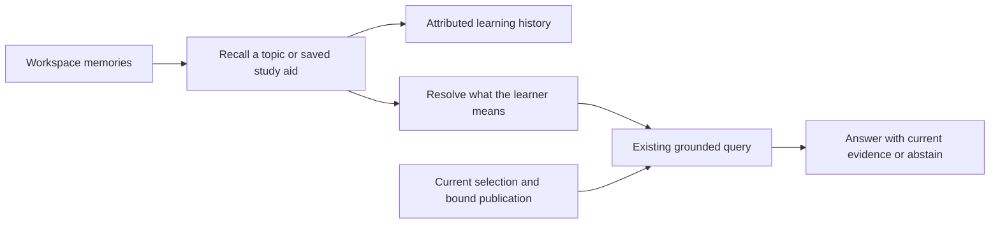

# Seneca Knowledge Memory — implementation design proposal

This supplement describes how the original four-category architecture and workspace mockups could work against Seneca main at `5a703277`. The product goal is for Rich to resume learning in a new conversation, recognize his own contributions, and check current procedures against the selected manuals.

**Memory provides continuity. Sources provide factual authority.**

## Two paths through the workspace

The distinction matters even within a single response. “You saved this mnemonic” can be supported by a saved record. “The manual currently prescribes this procedure” requires supporting passages retrieved for this request. A link to a previously cited passage explains where a note came from. Only the canonical query can supply a citation for a new procedural answer.

## Records and ownership

Keep four categories. An **episode** records a learning event, a **semantic note** identifies a concept and its relationships, a **learning record** captures what the learner saved or corrected, and **derived knowledge** covers synthesized material such as study guides. Track origin separately on each item or constituent claim: source-grounded, user-provided, or generated. Saving a generated mnemonic records Rich's decision to keep it and preserves its generated origin. Discussion of a topic establishes exposure only. Mastery requires separate evidence.

Propose a workspace-local store beneath the existing application data root. A record has a stable ID, revision, workspace ID, category, origin, display text, normalized topic terms, creation time, and typed links to exact input revisions. Source-grounded entries also require the originating workspace revision, snapshot, source and document version, and the evidence IDs from the committed answer. Represent mixed-origin summaries as linked items. A citation's membership can be checked mechanically. Whether its passage supports an extracted paraphrase requires inspection or evaluation.

Use atomic workspace writes with expected-revision checks. Deduplicate a repeated save by its originating event and item identity. Preserve corrections as superseding revisions. Allow the learner to inspect, edit and forget saved items. Forgetting removes the text from recall and invalidates summaries that depend on it. Scope lookup and all link traversal to the owning workspace. Keep note bodies local by default. Any future use of an external resolver with saved text needs an explicit product and privacy decision.

## Write, recall and reconcile

1. **Capture.** In a workspace with memory enabled, capture the topic and source references after a grounded turn commits. Extract candidate concepts from that completed exchange. Prefer source labels and exact terms for the first pilot. Store generated interpretations with their parents. Support explicit save for personal notes and generated aids through the existing workspace UX. Cancellation or a failed scientific commit produces no completed-learning event. A failed memory write leaves the committed answer usable and a save retry idempotent.
2. **Recall.** Read within the active workspace, match indexed topics and exact acronym strings, then follow bounded links. Return the user's wording for an explicitly saved mnemonic. Label study summaries with origins and links to their inputs. Ordinary factual questions continue through the existing turn orchestrator. Memory may supply topic or acronym hints for reference resolution. Pass only the resulting retrieval question into the existing snapshot-bound query. A memory ID is never a permissible document citation.
3. **Reconcile.** Resolve the current selection and published backing on every factual turn. A source revision makes the previous note historical for that publication. Preserve its original lineage and link a new revision only after current evidence supports it. Deselection immediately excludes that source from factual support, including via derived summaries. A discussion-history request can acknowledge the saved event. If no eligible evidence supports a procedural question, use the existing insufficient-evidence response and offer to reselect an applicable source.
4. **Bound cost.** Use a local topic index and deterministic selection for the first pilot. Cap items examined, link fan-out and rendered tokens independently of saved-history size. Reserve space for the current question and canonical evidence first. Drop optional memory detail when space runs out. Record counts, token usage and recall latency without recording private text. Choose numerical budgets from a small pilot measuring both exact acronym recall and added CPU latency. FlexA-Mem motivates budgeting at read time. A reduction in BGE forward time would need separate measurement.

The existing [prior-turn validator](../src/offline_rag/app/conversation/prior_turns.py) caps caller-supplied history at six exchanges and 12,000 characters. Cross-session recall should work with empty prior turns. The [turn orchestrator](../src/offline_rag/app/conversation/turn.py) already resolves scope and runs the bound snapshot query under lifecycle ownership. Reuse it. The [conversation trace store](../src/offline_rag/app/conversation/traces.py) is privacy-minimized and expires records. Durable memory therefore needs its own retained, user-visible provenance independent of trace retention.

## Acceptance walkthrough

Use a synthetic training manual with two published versions, a second selected source that lacks the target fact, and a second workspace containing a similarly named topic. Give the versions distinguishable statements and evidence IDs. Predeclare the expected source, answerable claim and mnemonic before running the walkthrough.

| Step | Learner action | Observable pass condition |
| --- | --- | --- |
| 1. Acquire | Discuss the training topic with version 1 selected. | The workspace contains the episode, linked concept and version-1 evidence reference. An interrupted turn adds no completed episode. |
| 2. Synthesize | Simplify an acronym and save the resulting mnemonic. Repeat the save. | One saved aid preserves the exact letters, authorship and original concept links. The original terminology is still inspectable. |
| 3. Recall | Restart the application and open a fresh conversation with no prior turns. Ask what was learned. | The summary recalls the topic and exact aid with attribution. The other workspace cannot retrieve either record. |
| 4. Revise | Publish version 2 with a changed procedural statement, then ask about the procedure. | The current answer reflects the changed statement and cites its version-2 passage. The prior note still identifies version 1. Check the answer against the passage as well as checking IDs. |
| 5. Deselect | Deselect the manual, leaving only the insufficient source selected. Ask again. | Seneca abstains from the unsupported procedure and explains how to restore source coverage. A separate history request can still identify the prior discussion. Neither old citations nor the saved mnemonic leak the procedure into the factual answer. |

All five steps must pass together. Retain selected source IDs, snapshot IDs, record origins and revisions, citation membership, answer disposition, and reviewer assessment of support. A plausible summary alone cannot pass this scenario.

## Research references and their roles

| Decision | Reference and scope |
| --- | --- |
| Retain, recall and reflect | [Hindsight paper](https://aclanthology.org/2026.acl-demo.27/) and [implementation](https://github.com/vectorize-io/hindsight). Use its lifecycle as an architectural reference. |
| Categorize and link notes | [A-MEM](https://github.com/WujiangXu/A-mem). Preserve Seneca's explicit origin and revision on evolving links. [Mem0](https://arxiv.org/abs/2504.19413) supplies a complementary selective-retention precedent. |
| Fit history into context | [FlexA-Mem v1](https://arxiv.org/html/2610.33274v1) and [code](https://github.com/WujiangXu/Flex-Amem) describe immutable history and a per-call timeline with detail selected to fit the budget. [MemGPT](https://arxiv.org/abs/2310.08560) motivates bounded working context and persistent recall. |
| Reconcile changing knowledge | [Zep / Graphiti](https://arxiv.org/abs/2501.13956) provides a temporal precedent. Applicable publication and source selection determine authority in Seneca. |
| Consolidate and present | [RAPTOR](https://arxiv.org/abs/2401.18059) motivates hierarchical summaries. [NotebookLM](https://blog.google/innovation-and-ai/models-and-research/google-labs/notebooklm-student-features/) provides a product precedent for source-linked study materials. |
| Evaluate | [LongMemEval](https://github.com/xiaowu0162/LongMemEval) informs extraction, cross-session reasoning, updates, temporal reasoning and abstention. The walkthrough adds Seneca's citation and workspace isolation checks. |
| Decide factual authority | [Seneca A2](slice16_amendment_a2_conversational_grounding.md) governs the answer and claim-level citations. |

## First implementation increment

Build the walkthrough as one vertical pilot through the existing workspace UI, conversation path and local storage. Start with inspectable topic links and explicit saves. Evaluate usefulness with Rich, citation support with the two fixture revisions, and bounded recall cost with increasing amounts of unrelated history. Use those observations to decide whether more elaborate extraction or compression earns its cost. The external systems are design references. Their benchmark results do not establish Seneca performance. This revision proposes design only.

## SOL review addendum

SOL accepted `386e84da7009cb31ed2872015ad03437347c5eb9` as the implementation
direction. This addendum sets the delivery order and adds acceptance cases.
[Design assets](design-assets/workspace-knowledge-memory/README.md) records
asset custody and links to the complementary diagram. KM-01 implementation
begins upon HA authorization.

### KM-01 — Conversational recovery

Deliver recovery in the existing conversation UI before adding durable memory.
Project the canonical terminal status and reason already returned by the turn.
Use the request's bound source selection and available retrieval diagnostics
to qualify what happened. The query trace already records which stages ran,
attempt count and available timings. Where retrieval diagnostics are already
available, project only the fields needed for the guidance. Missing values
remain unknown. Produce recovery text from deterministic rules and leave the
next action to the learner.

| Observed result | Explanation and suggested next action |
| --- | --- |
| `insufficient_evidence` / `no_evidence` | The search returned no usable evidence for this question within the bound selection. Suggest a term, section title, or relevant source to select when available. |
| `insufficient_support` | The material retrieved did not support an answer. Suggest limiting the question to one concept or naming the version or section the learner means. |
| `conflicting_evidence` | The answer was withheld because the evidence conflicted. Suggest asking for a comparison or identifying the applicable manual and edition. |
| `model_declined` | Seneca could not produce a grounded answer from the retrieved material. Offer a narrower reformulation and avoid attributing the outcome to a specific retrieval defect. |
| `clarification_required` / `ambiguous_request` | Ask the learner to name the missing term or referent using the existing clarification path. |
| Runtime, provider, timeout or transport error | Preserve the actual error state and applicable retry guidance. A failed request carries no conclusion about source coverage. |

Use source labels from the bound workspace only. Never infer that a manual
lacks a topic from a single retrieval observation or treat elapsed time as
evidence quality. Prefer an editable suggestion over automatic resubmission.
The demo should show distinct guidance for empty evidence, conflicting
evidence, ambiguity, and a provider failure. Focused tests should verify the
reason-to-guidance mapping, generic behavior when diagnostics are missing,
empty citations on abstention, and zero additional retrieval or generation
calls for guidance. Successful cited answers retain their existing display.

### KM-02 — Persistent workspace knowledge memory

Extend the pilot to automatically organize completed discussions in an
enabled workspace. Use bounded extraction from each committed exchange.
Represent episodes and proposed concept notes separately. Match exact
terms and supported aliases to existing concepts and record related-topic
links with their source events. Treat uncertain associations as proposals.
Retrieve topic material through a bounded local index. Preserve inputs and
origins for later summaries.

Demonstrate at least two completed discussions on the same topic and one
on a separate topic. With no manual saves, a later session should surface
the related discussions together and keep the separate topic out. Verify
that duplicate delivery does not create duplicate notes and that a memory
read or write failure leaves a successfully committed answer available.

### KM-03 — Mnemonic authoring and cumulative synthesis

Build on KM-02 to show a cumulative topic summary spanning the linked
discussions. Group related concepts by topic, preserve attribution, show
changes over time, and link each summary item to the source or discussion
that supports it. Check that a new relevant discussion extends the summary
without flattening disagreements or duplicating the same concept.

Use **ALVESCOUP and WASSPOC** as a dedicated combination case. Use the actual
expansions from approved selected sources when available. Attribute any
learner-provided expansion as such. Collect a concept list for each original
acronym before authoring the combined aid. Each row in the coverage view
identifies the original acronym and term, definition and origin, original
evidence reference where applicable, and the combined cue or an explicit
uncovered status. Merge overlapping rows only when the meanings match and
preserve both lineages. Show unresolved, missing, or conflicting definitions
explicitly. A partial aid can be reviewed and saved as partial.

Pass the complete case when a reviewer verifies the real definitions,
all source-supported concepts are mapped without semantic loss, the original
acronyms remain inspectable, and a fresh session can recall the exact saved
aid with its generated origin. The incomplete fixture must leave unknown
expansions unresolved and withhold complete-coverage status. The accepted
materials supplied for this review do not contain verified expansions.
The real-definition case requires the underlying sources.

### KM-04 — Learning and Training Mode integration

Surface saved aids and linked topic history in the existing learning and
Training Mode flows. Distinguish prior exposure, a saved aid, and assessed
performance. Preserve the existing evaluation and Gold authority. Use the
five-step walkthrough as the integrated product demonstration, with the
automatic organization and acronym cases alongside it.

### Proposed narrow A2 extension

Allow an enabled workspace to retain typed learning records beyond the
caller-supplied prior-turn window. Durable recall may support explicit
learning-history requests and provide bounded reference hints for resolving
a question. It cannot widen the selected source set or become answer
evidence. The existing leased publication, source filtering, retrieval and
claim-level citation validation govern factual answers. A historical citation
is provenance for the saved item. A current procedural claim requires
support from evidence eligible for the new request.

Keep storage, indexing and recall local. A post-commit memory failure
cannot roll back a valid answer, and a failed recall proceeds through the
existing conversation path without memory. Keep extraction and summaries
bounded and outside the required grounded answer path. Reuse committed
outputs where possible and avoid extra provider calls for the recovery
increment. Verify each increment through the normal workspace UI and focused
acceptance tests.
